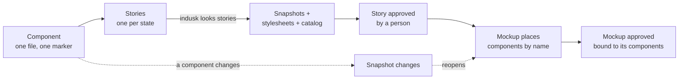

# Components and stories

How an app's UI is built from parts that exist once, each shown in every state
it can be in, and how a mockup is made of those parts instead of a drawing of
them.

## Why it exists

A mockup is a picture. Left to itself, the app's code drifts from it: the same
button gets written three ways, a "small tweak" to one copy leaves the others
behind, and a mockup approved last week describes a button nobody ships. Two
rules close that gap. A component is **implemented once**, and a mockup
**places** it by name instead of redrawing it. A component that changes then
reopens every mockup that uses it, so the approval is never about a part that
has since moved.

## The vocabulary

| Term | What it is |
|------|------------|
| **Component** | A reusable part of the UI, one file, whose root element carries `data-component="<name>"`. Presentational: its data arrives as props. |
| **Story** | One state of a component, written beside it (`<Name>.stories.tsx`). A story is named `<component>.<state>`. |
| **Snapshot** | The markup a story rendered, written by `indusk looks stories <app>` to `.indusk/mockups/<app>/components/<name>.<state>.html`. |
| **Stylesheet** | `components/<name>.css`, generated per component from the app's compiled CSS, resolved to the foundation's tokens. Never edited by hand. |
| **Catalog** | `.indusk/mockups/<app>/components.json`: every component, its file, its properties and each state that has a story. Read with no server running. |
| **Composed mockup** | A mockup that places components with `<indusk-component name="…" state="…">`. It draws only its own page chrome. |

## The flow



## A component, and its stories

A component is one file under the app's components directory. Its root element
carries `data-component="<name>"`, and no other file renders that marker: a
name marked on two implementations, or a screen that writes a component's
element out beside its own file, is refused by `indusk looks lint`, naming the
files and lines.

Each state a mockup shows has a story. A component state with no story is
reported by name, and `indusk looks coverage` lists a state with no approved
story as uncovered.

## Snapshots and stylesheets

`indusk looks stories <app>` runs the app's own Storybook runner in a real
browser and writes, for each story, the markup it rendered. It also writes each
component's stylesheet: the app's compiled rules for exactly the classes that
component's snapshots use, with every build variable resolved until only the
foundation's tokens remain. A stylesheet is generated and unlayered, so a
composed mockup draws a component as its story does, and it is read by the same
no-raw-value check as the mockup itself.

The command is deterministic: running it twice over unchanged components writes
identical files, so no approval moves.

## Composed mockups

A mockup places a component by name and state:

```html
<indusk-component name="look-row" state="approved"></indusk-component>
```

Composing the mockup inlines the component's snapshot and its stylesheet, and
the mockup's hash binds them (`componentsHash`). The lint refuses a mockup that
draws a component's markup itself, and one that names a component or a state
with no approved story. A mockup that needs a part that does not exist declares
it new; the new component is then listed as needing a story.

A story is one fixed rendering, so a mockup shows each component's story
content and cannot pass it data. A state a mockup needs to show that has no
story is a missing story, not a missing mockup rule.

## Placing a component with its own words

A mockup places a component and gives it words. Bare content inside the
reference is the component's `children`:

```html
<indusk-component name="button" state="default">Create project</indusk-component>
```

A named property is filled with `<indusk-content for="<property>">`:

```html
<indusk-component name="step" state="working">
  <indusk-content for="name">Name your project</indusk-content>
</indusk-component>
```

The component's look is the approved snapshot's, unchanged; only the words
land where the story's own words were. A component placed inside a component
is composed in turn, so a screen is made of components and words alone.
Placed words are part of the mockup, so changing them returns an approved
mockup to proposed, as changing the component does.

## Approval, and taking it back

A person approves, never an agent. In the cockpit's Looks page, **Show:
Components** lists each component's stories. A story is approved against what
draws it: its snapshot's hash and its component's stylesheet's hash. A rule
changed in the app's CSS can change how a component looks while its markup
stays byte for byte the same, so the stylesheet is bound beside the snapshot,
and a changed stylesheet makes the story read proposed.

The story a person approves is the one they see. The Looks page draws each
story from its snapshot, in the checkout the page is reading (a plan's
worktree included), on the foundation's tokens and the component's stylesheet,
exactly as a composed mockup draws it. It does not frame the admin's own
`/storybook` build, which may be older or from another branch; `/storybook`
stays for browsing and for `indusk looks check`.

A mockup is approved against its own hash and its `componentsHash`, which
holds its components' snapshots and stylesheets. Both are required: a mockup
that composes components is refused when Approve leaves `componentsHash` out,
because the stylesheets it shows are not in the mockup's own hash. A mockup is
approved only while every story it composes is approved as it is now. Approving
a group that holds a mockup and the stories it composes records the stories
first, then the mockup, so one **Approve N selected** settles both.

**Unapprove** is the way back, and it is also a person's: the button appears on
an approved mockup or story and not on a proposed one, and it sends the hash the
page showed, as Approve does. The look reads *proposed*, as withdrawn by that
person; the record keeps its whole history, and approving it again makes it read
approved. An agent's `indusk looks unapprove` is refused, naming the cockpit.

A component's markup or style changing makes its story read proposed and every
approved mockup that uses it read proposed too, naming the component. So does
a person's Unapprove of a story: each mockup composing it reads proposed,
`component changed: <name>`, in the status, the coverage and the lint alike,
and reads approved again once the story is approved. A mockup that does not
use it stays approved.

## The catalog

`components.json` is how an agent finds what exists before writing a component:
the file, the properties, the states. A component implemented in the app but
missing from the catalog is reported by name. Storybook itself is served by the
cockpit at `/storybook`; nothing is run beside it.

## The cockpit as the worked example

The InDusk admin is the first app built this way. Its nineteen components live
in `apps/indusk-admin/src/components/ui/`, each with its stories; its eleven
mockups are composed of them and were approved on the Looks page, which also
frames each story at its own size with a reference device on request. The
[component conventions](/reference/admin-ui/component-conventions) list each
component, its file and its states, and how to add one.

See also [UI promises](/guide/ui-promises) for the foundation and the held
check, and the [`indusk looks` reference](/reference/cli/looks).
