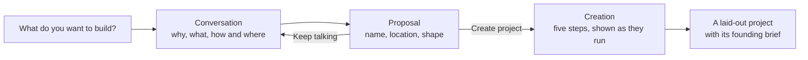

# Starting a project

A new project starts as a conversation in the admin. You say what you want to
build; the agent asks only what that leaves open, then proposes the project's
name, location and shape. Nothing is made until you accept the proposal.



## Where new projects go

The start page shows the folder new projects are made in, with **Change**. With
none set, the page asks first - "Where should new projects go?" - and **Start**
waits until you save one, so a project can be made with no command typed. The
folder is the same setting `indusk new-project parent <dir>` writes; the command
stays for scripts. The agent is told the folder, so the location it proposes is
one creation will accept.

## The conversation

**Start** launches the agent at once: the conversation opens with the agent
already working, and there is no second button to press. Every reply from the
agent carries a dot that says where it stands: a pulsing dot and **Working…**
while it works, a green dot once it has replied, and a grey dot with a line
saying to write below to pick the conversation up when it stopped before
replying. (A conversation whose agent is not running offers **Talk to the
agent** or **Reopen the conversation** instead.)

The conversation reads as a thread: your words to the right, the agent's replies
on the left. A reply is a few sentences of Markdown, with at most three
questions at a time. The agent's working - the files it read, the notes it
wrote, what it said on the way to the reply - is folded away behind **See more
›**; **See less** hides it again. A question the agent is waiting on, or a
request to use a tool outside the conversation's folder, is never folded: it
stays in the reply, to answer in place.

The agent works in the conversation's own folder and nowhere else. It may read
and write files there (`Read`, `Write`, `Edit`, `Glob`, `Grep`) and nothing
more: a shell command, a web fetch, an MCP tool, or a path outside the folder is
refused, and the agent is told why, without asking you. So an abandoned
conversation leaves nothing behind it but the folder, which discarding removes.

Everything said is kept in the conversation's draft as `transcript.jsonl`. Leave
the page and come back with no agent running and the same thread is there, with
a reply box; sending a message starts the agent again with your words. Discarding
the conversation removes the transcript with the rest of the draft. `indusk
new-project transcript <id>` prints it, one JSON line per event.

The plan conversation, builds and **Fix with Claude** still use the session
panel; the project conversation goes first.

## The proposal

When the agent has settled why, what, and how and where, it writes a proposal
and the admin's `/new/<id>` page becomes that proposal. Every part of it is
yours to change before you create anything:

| Part | What you can do |
|------|-----------------|
| **Name** | Rename the project. It is a folder name: lower-case words joined by hyphens. |
| **Location** | Change where the workbench goes. Creation accepts only a place under the parent directory you configured (`indusk new-project parent <dir>`). |
| **Shape** | Change the repositories the workbench holds. The layout shown is the one that will be created: the workbench, each repository inside it, a `worktrees/` folder beside them. |
| **How you'll plan** | See which planning documents the project writes, in order. |
| **Recommendations** | Each practice the agent recommends (a docs site, telemetry, deployment) is kept unless you decline it. |
| **Founding brief** | Read the brief the conversation produced; the documents you gave are kept unchanged beside it. |
| **Private GitHub repository** | A separate confirm. It opens unticked whatever the agent wrote, and only your tick creates one. It is the only step that sends anything off your machine. |

**Keep talking** goes back to the conversation; the proposal is kept and you
can return to it.

## What can be turned off

A project always plans with a **brief** that makes promises and a **test
plan**: they are how you know the project does what you asked. The other
planning documents (research, the decision record, the retrospective) can be
turned off. A proposal that turns off the brief or the test plan is refused,
naming the document, and so is a config that does.

A turned-off document is recorded in the project's config:

```json
{ "planning": { "documents_off": ["adr"] } }
```

A plan in that project then reads the document as **skipped**, never
**missing**, the planner does not write it, and the plan's next step does not
ask for it.

## Declining a recommendation

Declining asks for your reason, in your words, and records both in the
project's config under `recommendations`:

```json
{ "recommendations": [{ "name": "adr", "kept": false, "reason": "Solo project for now" }] }
```

A private GitHub repository you leave unticked is recorded the same way, as
`{ "name": "github", "kept": false, "reason": "not confirmed" }`, unless the
proposal already declines it in your words.

Declining a recommendation named for a planning document (the decision
records) also turns that document off. **Keep it after all** takes the decline
back, and the document with it.

## Creating the project

**Create project** keeps your edits, then makes the project from them: the
proposal you see is the one that is made, and anything the agent writes after
you press it is not used. The page shows
each step as it runs, with a dot for where it stands, and ends with **Open the
project**:

1. **Workbench created** - the folder at the location you chose, with its `worktrees/` folder.
2. **Repository created inside it** - each repository, a git repository on `main` with one commit.
3. **InDusk installed** - the package's own `indusk init`, run as a separate process. Creation then reads the project: its skills, its hooks and the `indusk` MCP entry must all be there, and a missing one fails this step and removes what was made.
4. **Founding brief and master plan written** - see below.
5. **Private GitHub repository created** - only when you confirmed it.

The result is the same layout every time:

```text
homework-gate-workbench/        the workbench: InDusk's home and a git repository of its own
  homework-gate/                the repository
  worktrees/                    one folder per plan's branch
  .indusk/config.json           declares the repository and its worktrees folder
  .indusk/planning/
    project-brief.md            the founding brief, from the conversation
    sources/                    your documents, byte for byte
    master.md                   the milestones, in order, as the plan order
```

The project is registered, so it appears on the home page, and `indusk
worktree list` reports its repository and worktrees folder with nothing
unattributed.

If a step fails, everything the creation made is removed (the folders and the
registry entry), the conversation is kept, and the page says which step failed
and why, with **Try again** and **Change the proposal**. Reloading the page
(`/new/<id>?creating=1`) shows where the last run stopped.

## The parent directory

A project is made only inside the parent directory you configured, from the
start page or with the command:

```bash
indusk new-project parent ~/code/sandbox
```

With none set, creation is refused and the message names that command. A
proposal whose location is outside it is refused, and nothing is made. The
comparison is by real path, so a symbolic link inside the parent that leads
out of it does not get a project written beyond it. A location inside an
existing git repository under the parent is refused too, naming that
repository, and the repository is left alone. The agent proposes a location;
it never decides where the admin may write.

Creating a project ends its conversation: the conversation's agent is stopped
before anything is made, so it does not keep running in the deleted draft or
hold the one session slot, and a new project conversation can start at once.

## The remote repository

Creating a project sends nothing off your machine. The private GitHub
repository is its own confirm on the proposal, off by default. When it is on,
the last step runs `gh repo create <repository> --private --source <path>
--push` once. If `gh` is missing or not signed in, that step reports the
failure and the finished local project is left as it is - nothing else is
undone, and you can create the repository yourself.

## See also

- [`indusk new-project`](/reference/cli/new-project) — the commands behind the page.
- [Workbenches & Worktrees](/guide/worktree-setup) — the layout a created project has.
