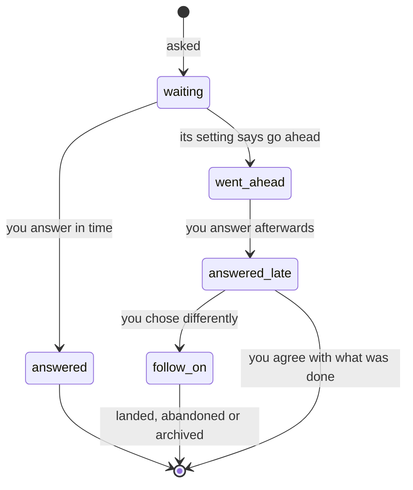

# Questions

An unattended run — a planning run or a build the admin started — meets choices the plan does not settle. It does not decide them silently and it does not stop for every one: it **asks each as a question**. A question carries its options, the one the agent recommends and why, a cost, and what each option changes. You see every question with its recommendation, and **each cost's setting says what an unanswered question does**: wait for you, go ahead after a set time, or go ahead at once.

## What a question is

The agent asks through the `ask_decision` tool. A question without two options, a recommended option, a reason or a cost is sent back to the session with what is missing; you never see one with nothing to accept. Each question has:

| Part | Meaning |
|---|---|
| Options | at least two; each can say what choosing it changes: the **brief**, a **promise**, a **look**, or a **gate** |
| Recommendation | the option the agent would take, and its reason |
| Cost | what getting it wrong costs: **cheap**, **moderate** or **expensive** — the agent states one |
| Deadline | a stored time, set when the question is asked from its cost's setting; none when it holds |

**The admin, not the agent, fixes the cost.** An option that changes the brief, a promise or a look, or skips a gate makes the question expensive; the cost is raised, never lowered. An expensive question that changes what was agreed **always waits for you, whatever the settings say**: no timer approves a brief, a test plan, a look or an ADR.

## What an unanswered question does

One setting per cost, in the InDusk home's `config.json` (`~/.indusk/config.json`, under `INDUSK_HOME` when set):

```json
{ "sessions": { "question_wait": { "cheap": 5, "moderate": "immediate" } } }
```

| Value | The question… |
|---|---|
| `"hold"` (the default for every cost) | waits for you, with no timer, however long |
| a whole number of minutes | goes ahead with its recommendation that many minutes after it was asked |
| `"immediate"` | goes ahead at once; the session is not stopped |

Anything else is refused when read, naming the key. With nothing set **every question waits** — answer everything first, then decide what to let go ahead. The deadline is a stored wall-clock time: restarting the admin never gives a question more time, and an admin that was down sends a due question ahead on its next read (late, never early).

## A question that waits stops its session

A question that holds ends the run's session and frees its place under `sessions.max`; a queued plan can take it. The plan is listed under **Needs you**, and its page shows the question's row. When you answer, the run starts again and its first message carries your answer. A question on a set time keeps its session and its place until the time comes or you answer.

## Answering

On the plan's page each open question is a row — expensive first, then oldest — with its options, the recommended one marked, and **Reply in words**. An empty reply is not an answer. See [the admin's sessions reference](/reference/admin-ui/sessions).



## A late answer that disagrees

If a question went ahead and you later answer with something else, the answer opens **one draft follow-on plan** naming the question, the choice made and the one you wanted. It is a draft: never accepted, approved or started by the answer. A second answer to the same question updates that draft rather than opening another. `indusk release` — never landing — **waits for open follow-ons**; see [`indusk release`](/reference/cli/release#waiting-for-a-follow-on). An answer that matches what was done opens nothing.

Every question stays in the plan's history in all four states (waiting, answered, went ahead, answered late), with its recommendation, answer and what was done, after the plan lands and archives.

## Never decided silently

A plan document an unattended run saves that says "decided unattended" for a choice, with no `question: <id>` beside it, is refused at save, naming the line; an id the plan's record does not hold is refused too. Review and acceptance are stops for a person, not questions, and are not checked. A run with a person present is asked, not checked. See `lesson: choices-are-asked-as-questions`.

## Signals

Each place that decides one of the plan's clauses reports it as upheld or broken: asking a question, the save check, the sweep, the stop and the answer that resumes, a late answer, the question record, the release's follow-on step, and landing. The close reads those reports. See [the decision](/decisions/decisions-as-questions).
