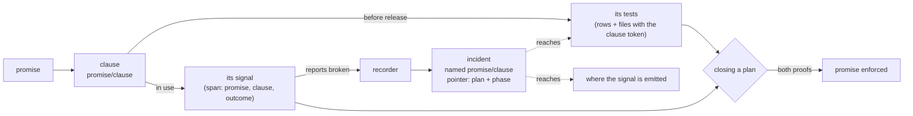

# Signals

A clause is proved twice: its tests run before release, and its signal reports it upheld in a run of the real system. This page is about the second proof.

## What a signal is

A **signal** is the report a running system makes about one clause of a promise: this part held, or it broke. It is plain OpenTelemetry on a span. The span names the promise and the clause, and says `upheld` or `broken`:

| Attribute | Meaning |
|---|---|
| `indusk.promise` | The promise's name. |
| `indusk.clause` | The clause the report is about. |
| `indusk.promise.outcome` | `upheld` or `broken`. Older writers wrote `violated`; every reader still takes both. |
| `indusk.signal.value`, `indusk.signal.bound` | Optional: what was measured and the bound it was held to. |

A broken report also carries an event with what was seen (the symptom), the promise and clause again, and `indusk.signal.plan` and `indusk.signal.phase`, the plan and phase that added the signal. InDusk's own commands write theirs through `markPromise` and the one tracer for commands (`commandTracer()`), which exports to the local daemon at its stored address and says nothing when no daemon runs. An application writes the same attributes itself, from the helper `indusk init` scaffolds.

## Derived from the clause, not from a test

A signal is written from the clause's sentence: where it is read, and what upheld and broken look like. A signal that copies the assertion of the test that proves the same clause is not a second proof. It runs the same inputs somewhere else and fails exactly where the test would have, and it misses what the test missed. The value of a signal is that it sees inputs nobody chose.

So a span made by a test run is not a signal. A writer under a test runner sets `indusk.run=test`, and every reader skips such a span: a clause with passing tests and a span from a test still reads **no signal**.

## The kinds

- A **split** is a point reached within its budget on the way to the promise's goal. It is broken by missing its budget at its point, so its newest report decides.
- A **limit** is a bound that always holds. It is broken by one report over its bound, however many reports were inside it.
- A clause that **rests on** another promise has no signal of its own: it reads as the promise it rests on.

## How a clause reads

| Reads | When |
|---|---|
| **holding** | Its signal reported upheld in a real run, nothing since breaks it, and the watcher that would hear a report is alive. |
| **no signal** | Nothing reported, or the watcher has gone past its heartbeat. Never drawn as holding. |
| **broken** | Its signal says so, or measured past its bound. |

A promise reads as its worst clause: broken, then no signal, then holding. Passing tests are not an input here. They are the first proof, checked when a plan closes or lands; the signal is the second.

## Fire rate

A signal that fires on every request fills storage and hides the clause it is about; one that fires on a rare path leaves its clause on "no signal" for a long time. Write the signal where the clause is felt, report once per thing that happened rather than once per check, and when a path is rarely run, decide on purpose whether to wait for it, add a probe, or accept the silence.

## How a break names its clause

A break arrives at a person already pointing at the clause it broke, rather than at a list of test files.

1. The system's signal for the clause reports `broken`. The event it emits carries the promise, the clause, the symptom, and the plan and phase that added the signal.
2. The recorder (`recordBreaks`, run by the admin unasked) reads the break. Because a clause is a split or a limit, it reads promises of every kind that have such clauses, not only behaviour promises.
3. It opens an incident named `promise/clause`. The plan and phase come second, as a pointer: plans end and their notes are archived, but a promise and its clause do not.
4. From the incident a person reaches the clause's tests (the rows and files that carry its token) and the code sites that emit its signal, with no search by file name.
5. The recorder writes its own signal for `a-break-names-its-clause`: upheld when every incident opened by a clause's signal names `promise/clause`, broken when one names only a promise.

A promise written before clauses has no clause to name, and its incident is the one it always was.

## Closing and landing read the system

A plan written as clauses (`clauses: required` in its brief) does not close on a `passing` cell. Closing runs the tests each clause's rows name, now, and asks the local daemon whether each clause's signal has reported upheld, and refuses by `promise/clause`, saying which half is missing. Landing runs the tests half. A stopped daemon refuses and says how to start it; it never passes. See [`indusk promises confirm`](/reference/cli/promises#a-plan-written-as-clauses) and [the decision](/decisions/mark-first).

## See also

- [Briefs: promises as clauses](/guide/briefs#promises-as-clauses)
- [Test trajectory: closing runs the clause's tests](/guide/test-trajectory#phase-close-is-structurally-enforced)
- [Promises](/guide/promises)
