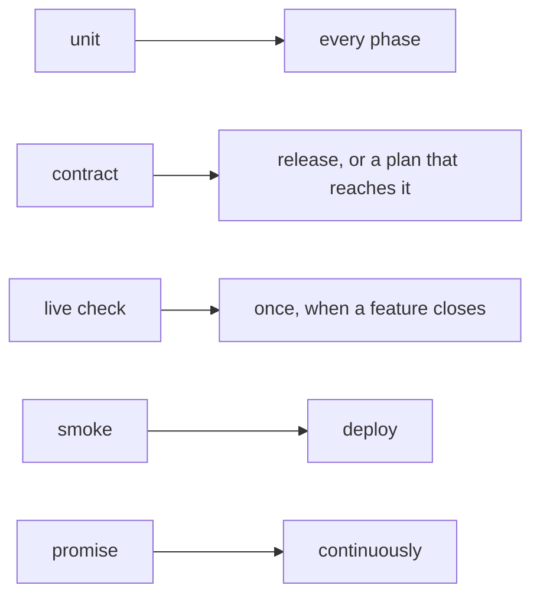

# Test levels

A test answers one question, and its **level** says when that question is worth
asking. Every assertion in a test plan names one of five levels, and every row
of an impl's Test Trajectory carries it in its `Level` column.

It was first called the test's *kind* (1.61.0). A promise already has a kind
(behaviour, state, structure), and a test row names both, so the test's word
became *level*. An impl written with `Kind` and `test_kinds: required` still
validates.

| Level | The question it answers | When it runs |
|---|---|---|
| `unit` | Is this rule right? | In the phase that writes it; part of `pnpm test` |
| `contract` | Do we still fit something we do not own: Jaeger's API, npm, a browser, the OS, Claude Code? | `pnpm test:system`, on release, and in a plan when its rows or changes reach the file |
| `live check` | Does the whole story work against the real system? | Once, recorded in the plan with its result |
| `smoke` | Is the deployed thing alive? | At deploy |
| `promise` | Is it still true in production? | Continuously, by the watcher |

## The smallest level that can prove it

An assertion's wording is behavioural: what someone outside sees. Its level is
usually `unit`, because the behaviour is decided by a rule, and a rule is tested
by feeding it inputs. "A break that reaches Jaeger late still turns the
chip red" is a rule about what the store reads, so it is a `unit` test. "Jaeger
still answers our query the way we expect" is a question about Jaeger, so it is
a `contract`.

Name the smallest level that can prove the assertion. Reach for `contract` only
when the question is about the thing you do not own.

## Code that decides takes its clock and its reads

A rule can only be a `unit` test if the test can give it its inputs. Code that
decides takes an optional last argument with its clock and its reads, with the
real ones by default. A test passes a fake that answers from a list, and a clock
it moves. The admin's mark store and health read work this way: nine rules that
took 216 seconds against `next dev` and real Jaeger servers now take under half
a second.

## Two tiers

Each package lists, in `vitest.tiers.ts`, the files that start a server, a
detached process or a packed tarball, or that wait on the wall clock. A test
that starts InDusk's command line, git or another Node process is a system test
too, and so is one that calls a shared helper that starts one (`runHook`, `git`;
the guard reads the helpers): a process start is most of what made the everyday suite slow (125 such
files were 80% of its 150 seconds on 2026-10-17). Those files are its **system
tier**.

- **`pnpm test`** is everything else: rules, in under a minute (54 s on 2026-10-18), with both
  packages in parallel. A phase runs only its own rows' tests and
  `vitest related` over the files it changed. That takes seconds.
- **`pnpm test:system`** runs both packages' system tiers, on release (after
  the publish, blocking nothing), and a plan runs a file from it only when one
  of its rows names the file or its changes reach it.

A system-tier test waits on the event it expects, never on a fixed number of
seconds a busy machine can outlast. The recorder test, which starts the
admin and a break the admin should commit, waits through one rule
(`waitForIncident`): it passes when the incident appears, fails naming the
break when the admin has finished a scan after the break was loaded and found
none, and keeps an upper bound (four minutes) only to end an admin that hangs.
The admin writes each scan's start, end and outcome to a scan record in machine
state, which is what the test reads; a scan that threw does not count as
finished. Landing reports the result as the signal for
`landing-tests-hold-under-load/recorder-waits-for-its-break`.

## What a plan runs

A plan does not run `pnpm test` while it is built or when it lands. One
command, [`indusk plans tests`](/reference/cli/plans#plans-tests-name-phase-ref-landing-list),
computes what it owes:

- **At a phase** (`--phase N`): the test files of the rows that phase writes or
  makes pass, and the tests of each promise the brief lists as Must not break.
  Seconds.
- **At landing** (`--landing`): every row's tests and those same promises' tests.

Each file prints with the reason it is in the set. Until
the sampler (the next plan) runs the rest behind the scenes, a test no plan
names or protects does not run unless a person runs it, however many files it
imports from the ones the plan changed.

No test run is replayed from turbo's cache (`"cache": false` on the `test`
task). turbo keys a cache on a package's own files, and some tests read beyond
their package: the never-wait guard lives in mcp and reads the admin's tests.
A replayed green answers a question about an older tree.

## The suite's own promises

InDusk keeps this the way it keeps anything else, as promises:

- **`everyday-tests-never-wait`** (structure). A guard reads every everyday
  test file in both packages and fails, naming the file, line and call, if one
  starts a server, the command line, git or another Node process, or waits on
  the clock.
- **`everyday-suite-stays-fast`** (behaviour, watched; replaced by
  `a-plan-runs-its-tests-and-what-must-not-break` when its plan closes). It is
  no longer marked: each `pnpm test` run's seconds are appended to
  `suite-durations.jsonl` in the project's machine state, with whether the run
  passed and whether it overlapped another test run (an evaluator's, usually).

See the [decision](/decisions/test-kinds) for why.
