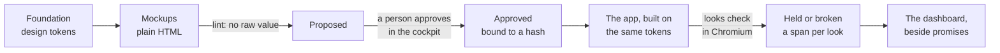

# UI promises

How an app looks, held the way a promise is held: drawn first, approved by a
person, and checked in the running app by value.

## Why it exists

A screen can pass every test and look nothing like the design it was built
from. There was no commitment about appearance to break, so nothing broke. A UI
promise gives appearance the three things a behavioural promise has: a
**statement** (an approved mockup), an **owner** (the person who approved it)
and a **check** (the running app, measured).

## The flow

## The foundation

One file, `.indusk/mockups/<app>/foundation.tokens.json`, in the
[Design Tokens format](https://www.designtokens.org/): colours, spacing, radii,
type, shadow, duration and easing. Every visual value in a mockup or in the app
comes from it. A mockup that needs a value the foundation lacks declares it
new; one that writes `#c2620b` or `13px` is refused, naming file, line and
value. `indusk looks tokens <app> --tailwind` turns it into the app's theme and
resets Tailwind's stock palette, so a stock class has no value to compile to.

## Mockups

A mockup is a plain HTML file, `screens/<screen>.<state>.html`, that loads only
the generated tokens. The cockpit opens it at each of the app's reference
devices. Components are marked `data-component="<name>"` in the app, once each,
and a mockup places them by name rather than drawing them: components and their
stories come first, then the mockups composed of them, so coverage can say which
parts of the UI no approved mockup shows. See [Components and
stories](/guide/components).

## Approval

Approving is a person's act, in the cockpit's Looks page. An agent can draw and
propose a mockup and cannot approve one: the command refuses and a hook refuses
an agent's write to the record. An approval is bound to the content hash of the
mockup and the foundation it was drawn on, so changing either returns it to
*proposed* by itself, and the app is held to the last approved version
meanwhile.

Every row on the Looks page says what it is, on a line of its own above the
look's name: **Mockup** (a drawing, approved to say this is how it should look)
or **Story** (the built component, approved when it matches its mockup).

Approval happens in the checkout the plan is worked in — a plan's worktree
commits it on the plan's branch — so it merges with the mockups it judges.

**A look belongs to the plan that made it.** Each approval records the plan whose
checkout it was made in (`plan/x` records `x`), so the cockpit can say whose a
look is without a registry of its own. The record is append-only: a plan that
redraws an approved look leaves the earlier approval beside the new one, which
is that look's history. A plan's [brief](/guide/briefs) lists the looks it
makes, changes or replaces, and `indusk plans approve` waits until each mockup
among them is approved in the plan's worktree; a story is approved at the
build, once its component exists.

## Held by value

`indusk looks check <app>` opens each approved screen state at each device in a
real browser and decides two things: each foundation token on the page equals
its approved value, and every colour, length, radius, shadow, font and
transition on every element is one of the approved values. A token changed in
the app alone breaks that token and every element using it, naming the
element, the property, and the approved and actual values. Each look is
recorded as a span, so it appears on the dashboard beside promises.

**Checking looks costs what changed.** A look unchanged since it last held —
the same foundation, declarations, devices, snapshots and, for a screen, page
code and seed — is reported `reused` from that result instead of being opened,
so a check after a small change opens only the looks that change touched. After
changing a component, render the stories first
(`indusk looks stories <app>`), then check: the stories are what a story look and every screen
composing it are held to, so until they are rendered from the sources as they
are, nothing is reused and the check says so. A screen's data is in no key —
a new element that appears only because the data changed is not seen by a
reused look — so a UI plan's live check runs `indusk looks check <app> --all`,
and so do the slow tests, in the background after every landing and at every
release. A reused look still sends its span, marked reused with when it was
really measured, so its standing reads holding and never decays to no signal.

## The cockpit as the worked example

The admin was the first app held. Its foundation was redrawn from the cockpit
design (`plan-cockpit.html`), eleven mockups were drawn on it and approved, and
the admin was restyled so that every class comes from the foundation. Changing
one colour token in its generated stylesheet alone makes `indusk looks check
admin` report that token and each element that used it broken.

See the [`indusk looks` reference](/reference/cli/looks) and
[the decision](/decisions/ui-promises).
