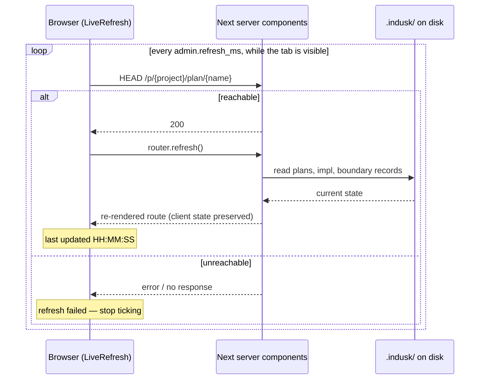
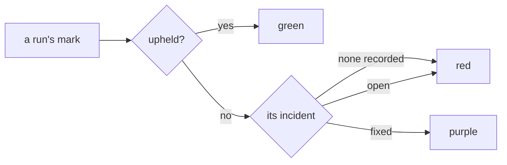

# Admin UI — Overview

The InDusk admin UI is a read-only viewer over every InDusk project's `.indusk/planning/` directories and its evaluation results in its home (`indusk eval home`). It's the first Arc 1 demo asset: a visible, demoable surface for the working agent's flow (plans, phases, trajectory rows, falsification logs, eval scorecards).

Since 1.27.0 it runs as a **single long-lived local daemon** — one Node process serves every InDusk project on your machine, not a new Next.js instance per project. You start it once with `indusk ui start`, close your terminal, and it keeps running in the background until you `indusk ui stop`.

## The daemon model

```mermaid
sequenceDiagram
    actor You
    participant CLI as indusk ui start
    participant Daemon as Admin UI daemon<br/>(detached Node)
    participant Registry as ~/.indusk/projects.json
    participant Browser
    participant FS as Project .indusk/

    You->>CLI: indusk ui start
    CLI->>CLI: check ~/.indusk/admin-ui.pid<br/>(already running? no-op)
    CLI->>Registry: read registered projects
    CLI->>Daemon: spawn detached: next start -p <port>
    Note over Daemon: writes pid, port, log<br/>to ~/.indusk/admin-ui.*
    CLI->>Browser: open http://localhost:<port><br/>(cwd-aware: /p/{project}/ or /)
    CLI-->>You: "Admin UI running at ..."<br/>(CLI exits; daemon persists)

    Browser->>Daemon: GET /p/{project}/plan/{name}
    Daemon->>Registry: resolve project name → path
    Daemon->>FS: read planning/{name}/*.md, eval/results.log
    Daemon-->>Browser: rendered plan page
```

The daemon reads `~/.indusk/projects.json` on every request, so newly `indusk init`'d projects appear without a restart. It does not watch the filesystem — each browser request re-reads from disk, which is fine at the scale of a single developer's local projects.

When you close your terminal, the daemon survives: it was spawned with `detached: true` and inherits no parent process handles. `indusk ui stop` finds it via the pid file and sends SIGTERM.

**The daemon records production breaks** (incident-recording). While it runs, with no page open, the daemon checks every registered project that names a production source (`promises.jaeger`) once per `admin.refresh_ms`, and records each break it finds as a committed incident that reopens the owning plan, through the same writer as `indusk promises watch`. A project with only a local source is not checked: a local break is work in progress. Stopping the daemon stops the checking; catchup records whatever it missed. See [the decision](/decisions/incident-recording).

## The registry

`~/.indusk/projects.json` is the canonical list of projects the admin UI knows about. It's populated by two CLI commands:

- **`indusk init`** — appends a new entry for the project it's initializing (`addProject(projectRoot)`)
- **`indusk update`** — validates the entry exists and matches the current path, touching its `lastSeenAt` timestamp (`validateProject(name)` + `touchProject(name)`, or `addProject` if the entry is missing or diverged)

Registry entries look like:

```json
{
  "version": 1,
  "projects": {
    "dusk": {
      "path": "/Users/you/code/dusk",
      "registeredAt": "2026-04-19T...",
      "lastSeenAt": "2026-04-20T..."
    },
    "numero": { ... }
  }
}
```

No auto-pruning. If a registered project's path is deleted from disk, `indusk ui status` still lists it and `/p/{name}/` renders a **stale failure page** (HTTP 200 with a "needs reconfiguration" affordance — never 500 or 404). Recovery is user-action-only: `cd` to the project's current location and run `indusk update`, or hand-edit `~/.indusk/projects.json`. The registry is mutated only by CLI commands.

## Routing tree

```
/                                    # Project grid — one card per registered project
/p/{project}/                        # Per-project home (sidebar + empty state)
/p/{project}/scorecards              # Per-project eval scorecards (1.27.2+)
/p/{project}/plan/{name}             # The plan page: frame, parts, status
/p/{project}/plan/{name}/brief       # Where the plan is written: its parts, the brief and the planning agent
/p/{project}/plan/{name}/doc/{doc}   # One of the plan's documents on its own page
/p/{project}/draft/{id}              # A conversation not yet kept as a plan (brief-as-the-contract)
/p/{project}/looks                   # Each app's mockups, Approve, what is uncovered (ui-promises)
/p/{project}/research/{slug}         # Per-project standalone research (1.27.2+)
```

Everything is project-scoped under `/p/{project}/...`. The top-level home at `/` is the cross-project entry point (project grid); there is no other cross-project view. The grid shows every registered project whose path exists, each card labelled `workbench` (its config declares repos — the package's `isWorkbench`, never inferred from layout) or `normal-mode`; entries whose path is gone are not projects and are listed in a collapsed "not found (n)" note that points at [`indusk ui prune`](./cli#indusk-ui-prune-dry-run). 1.26.0/1.27.0 had a top-level `/scorecards` that walked every registered project — **removed in 1.27.2** in favor of per-project scorecards at `/p/{project}/scorecards`. The per-project layout at `app/p/[project]/layout.tsx` owns the sidebar, plan list, Scorecards link, Research group, and project switcher; the root layout (`app/layout.tsx`) is global-nav-only.

## What each page shows

**`/` (project grid)** — one card per registered project with name, path, last-seen-at, and active-plan count. Clicking a card navigates to `/p/{name}/`.

**`/p/{project}/` (per-project home)** — sidebar + empty-state main pane. Sidebar structure (top to bottom):

1. **Header** — the `Nav` component's head: the project's name with its plan count ("9 plans") and the collapse button, then `<ProjectSwitcher>` to jump between registered projects.
2. **Needs you, then the views** — plans waiting on you, then Scorecards, Promises and Looks, each a `ViewLink` (a mark, a name and a count), direct to `/p/{project}/scorecards` and `/p/{project}/promises` (always present). Promises carries the number of broken promises and broken looks when any are, the same count the dashboard shows; **Looks** sits under it, linking `/p/{project}/looks`. The open page's entry is marked current on every page.
3. **Plan list** — one root node (the root `master.md`'s title) with the declared Paths and every unclaimed plan beneath it (admin-ui-phase-progress, 2026-09-16): see [The nav](#the-nav). `Archived (N)` stays outside the root, collapsible at the bottom. Each plan link routes to `/p/{project}/plan/{name}`. No root master → no root node, the tree renders flat.
4. **Unassigned worktrees** — every worktree of the project's repository that holds no plan assignment, with its branch (admin-plan-worktrees, 2026-09-18). Omitted when there are none.
5. **Research group** — listed slugs from `.indusk/research/` when the directory exists and contains at least one entry; omitted entirely when empty.

### Drafts

**New plan** on the project's home asks for nothing: it opens an empty draft in the project's home and moves to `/p/{project}/draft/{id}`, where a box takes what you want and the conversation runs. The agent works in the draft's own folder, so nothing is written in a checkout. The page shows the promises, expectations and looks the brief has so far, and, once the agent has proposed a name and type, the proposal with **Accept** and **Edit** (a workbench of several repos also asks which repo). Accepting runs [`plans start --from-draft`](/reference/cli/plans) and moves to the plan. The project home lists conversations not kept as **Drafts**, each with **Reopen** and **Discard**.

### The plan page's parts

A plan's page draws the three parts of its brief above the plan's stage, each with its name and state first and the detail one click on ([Briefs](/guide/briefs)):

- **Promises** — the registry rows the plan owns (and any the brief makes that the registry lacks, marked `unregistered`), each a pill with its state: declared, enforced or known-violated.
- **Expectations** — the brief's expectations, each with when to look at it; one whose time has come is drawn warm.
- **Looks** — each look the brief makes, changes, replaces or must not break, its row showing approved or proposed (a look not yet drawn reads *uncovered*). Open shows the look in the Looks page's frame at the app's reference devices; a look is approved only on the Looks page, in the checkout the plan is worked in, never here.

Below them, **Read the brief** goes to `/p/{project}/plan/{name}/brief`. When a promise, an expectation or a look changed after the person approved the brief, an **amendment** card sits above the decision the plan waits on, with what each was and what it is now; **Approve** there calls `plans reapprove`, and only from the person's own browser (the same `Sec-Fetch-Site: same-origin` check the look approval requires). All of it is read by the package's `plans/parts` from the plan's own checkout on every request, so what the agent writes appears on the next refresh without leaving the page. The review a built plan stops at shows the test plan, the ADR and the impl as **evidence** — read, not signed off; the person approved the brief.

### The brief page

`/p/{project}/plan/{name}/brief` is where a plan is written. The brief's parts (promises, expectations, looks) and the brief itself scroll on the left; the planning agent sits in a narrower column on the right that stays on screen, with **Approve**, which moves to the plan page. On a phone the page is one column and the agent's column flows under the brief. The agent follows what it writes: a part it just added is brought into view and marked for a moment. A planning session runs in `acceptEdits`: a write inside its own folder (the plan's worktree, or the draft's folder) and a tool given no path are allowed without asking, and only a path outside that folder reaches you to allow or refuse.

The plan page is where a plan is followed. It opens with the plan's **description** (the brief's `description:` field, read as YAML) and a link to the brief. Until the brief is finished by the rail's own rule (`accepted` or `complete`), "The brief is incomplete" is the plan's current step, with **Work on the brief**; a `superseded` brief and an archived plan have none. A draft accepted as a `spike` has no brief and lands on the plan page. The plan page's agent answers questions and sends a change to what was agreed back to the brief.

### Sessions

The admin runs one agent per plan and kind: a plan can have a planning session and a build at once, and plans run side by side. Only a second session of the same kind on the same plan is refused, naming the session already running. A draft's conversation is its own (`draft:<id>`) and never collides with a plan. A machine runs at most `sessions.max` sessions, 4 by default, set in `~/.indusk/config.json` (`{ "sessions": { "max": 6 } }`, under `INDUSK_HOME` when that is set); a start beyond the cap is refused, naming each running session, and a session is stopped from its plan's page. Every page asks for its own plan's session (`GET /api/sessions?project=&plan=&kind=`), and **Needs you** lists one entry per running session. See [the decision](/decisions/sessions-per-plan).

### The nav

The nav is drawn from components, as its approved mockups (`nav.expanded`, `nav.collapsed`) place them: `Shell` (the frame, with the nav's column and the page's), `Nav` (the project's name, plan count and collapse button, with `NavGroup` headings), `PlanRow` (a plan's mark, name and the step it is at) and `ViewLink` (Scorecards, Promises, Looks). A `PlanRow` or `ViewLink` given an `href` is a link and takes `aria-current` when its page is open; the plan tree (Paths, archived plans, unassigned worktrees, research) is the app's own and sits below the views, hidden when the nav is folded to its rail. The nav is on every project page — a plan, the dashboard, a promise — and lists every active plan in the project, so any plan is one click away (plan-cockpit).

- **Needs you** lists each plan waiting on the person — a question its agent asked, approval, or review — with the step it waits at; its page shows the decision card. See [Sessions → Decisions](./sessions#decisions).
- **Paths nest as declared.** A parent plan is a Path; a subplan that is itself a parent opens as a Path inside it, to any depth (`data-depth` 1, 2, 3…). Each Path's plans are numbered 1-up in the order its `master.md` declares them. A master that names its own ancestor stops at the repeat. Plans no Path declares follow the Paths, in the master's order and then under *Unordered*; nothing a declaration says removes a plan.
- **Released counts.** Each Path shows `released/total`: how many of its plans (including those in the Paths inside it, and declared plans not created yet) a release has shipped, from the package's `planDates` — a plan that landed but is in no release is not counted.
- **On a phone** (under 760 px) the nav is a drawer: closed, opened by the *Menu* button, closed again by it, by the backdrop or by following a link. It takes no room from the page.
- **On a desktop** the collapse button in the nav's head folds the nav to a rail of marks: the project's name, the plan names, the groups and the counts are hidden and each row and view keeps its mark (a drawer is never folded). The choice is kept in the browser's `localStorage` (`indusk-admin.nav.collapsed`) and read after the page loads; a browser that blocks storage still gets the open rail.

Switching projects via the header does not restart the daemon — the registry resolves on every request.

**Which copy of a plan is shown.** Every plan is worked in its own worktree, so a project holds several copies of it. The admin reads each active plan from its **live copy**: from the worktree it is assigned to (by [`indusk worktree create` or `assign`](/reference/cli/worktree)), from the registered trunk otherwise. The documents, the parts and the active phase all come from that copy, including the phase-boundary record the worktree wrote. What the page says about it:

| Case | Plan row and frame | Notice under the frame |
|---|---|---|
| Read from its worktree | a `⎇ <worktree>` tag | none — the tag is the whole statement |
| Assigned worktree removed without release | no chip; trunk copy shown | "The assigned worktree `<path>` no longer exists — showing the trunk copy" |
| Two live worktrees assigned (a hand-edited record) | no chip; trunk copy shown | both worktrees by path |
| Archived on its branch, before the release (retrospective Step 9 → Step 10) | the chip; the worktree's archived copy shown | "archived in its worktree …, awaiting landing" |
| Plan folder gone from its worktree | no chip; trunk copy shown | "The plan folder missing in worktree `<path>` … — showing the trunk copy" |
| Not assigned | as before | none |
| Assignment record unreadable | name and `unknown` only | an error naming the record's file; no progress is drawn, because which copy is live is unknown. The sidebar carries the same error above the plan list. |

The resolver applies when the registered path is the top of a git checkout — the project is the repository. A project nested inside a larger repository reads the folder it was registered at, as before.

**`/p/{project}/plan/{name}` (plan page)** — under the frame (the crumb, the plan's name and its worktree tag) and the parts above, the plan's status is shown as its two workflows (plan-cockpit):

- **Planning** — the documents the plan's type requires, in order: Research, Brief, Test plan, Decision, Impl. A bugfix lists Brief, Test plan and Impl; a spike lists Research only.
- **Release** — Build, Falsify, Cleanup, Audit, Review, Release.

The page is drawn from components, as its approved mockups (`plan.needs-you`, `plan.working`, `plan.released`) place them: each list is a `RailGroup` of `Step`s in a rail, and beside it one `DecisionCard` says what the plan has to say — the decision it waits on (with its answers), a plan being built with its phases, or a released plan. A `Step` is the mockup's button drawn without a handler; no step can be set from the page. The header's worktree is a `Tag`.

Each list has its own count of steps done (`3 of 5`). A step is `done`, `in progress`, `needs you` (a document proposed and waiting to be accepted, or an impl waiting to be approved), `not yet`, `skipped` (the type has no such step, or a ritual was skipped with a reason — the reason is shown, and a skipped step is in neither number of the count) or `missing` (the type requires the document and the plan has moved past it). Every state is read from the plan's documents and where it stands, by the package's `plans/steps` — the same position the plan bar draws — and no control on the page sets one. The header names the plan by its title (the folder name beneath), with when it started, landed and was released, the Path or Paths that declare it (outermost first), and the promises it owns as chips — each its sentence and `passing/total tests`, linking to the promise's page. Today's documents, phases and test rows are under a collapsed **Details**; nothing was removed.

The parts below the status are each closed by default, a name and a one-line summary first and the detail one click on: Promises, Expectations, Looks, **Phases** (the current phase and items done, `Build Phase 4 of 6 · 38 of 52 done`; opened, each phase a row with its state, and a phase opened shows its items and the notes recorded under them), **Documents** (each of the plan's documents a row with its status, opening that document's own page) and **History** (what happened to the plan, newest first). The page draws nothing the approved mockups do not: no stage strip, no per-phase progress lines, no plan bar, and no inline document sections.

Which documents a plan has follows its type (admin-plan-type): a document the type does not require is not listed, and a required one the plan has moved past without is listed as missing, in the Planning rail, with the sentence *The test plan is missing — a bugfix requires it.*

**`/p/{project}/plan/{name}/doc/{doc}`** is one document on its own page, with a link back to the plan: research, brief, test-plan, adr, impl, falsification, cleanup or audit, whichever the plan has. A document the plan does not have is a 404. The plan page, the brief page and a document page find their plan through one lookup (`readPlanPage`): an active plan wins over an archived one of the same name, and a project whose path is gone renders the stale-project page.

**The page is live.** A small client wrapper, `LiveRefresh`, ticks every `admin.refresh_ms` from the project's `.indusk/config.json` (default 5000 ms, floor 1000; absent means default, and `indusk update` never writes the key). Each tick sends a `HEAD` to the page itself as a reachability probe and then calls Next's `router.refresh()`, which re-runs the server components for the route and streams the new tree in — so a checkbox written to `impl.md` reaches an open page within one interval, and the viewer's open sections and scroll position stay where they were. It says what it is doing (`last updated 14:02:11`), pauses while the tab is hidden, and when a probe fails it stops and says `refresh failed — reload the page to resume` rather than showing a stale page as live. There is no route handler, no fetch of a second data shape and no socket: one render path, whole-route re-render, which is the trade the ADR accepted at the daemon's scale.

**The Promises page is live the same way** (day-always-on). A violation reaching a deployed system's server has to turn its chip red without anyone reloading, or the page is a snapshot pretending to be a status board. Same wrapper, same interval — which is also the health read's cache lifetime, so one tick is one Jaeger read. No other page polls.



**Which phase is active.** The phase with the most recent boundary record (`.indusk/phase-boundary.jsonl`) among phases that still have unchecked items. A phase with everything checked is closed whatever its record says. With no records at all, the first open phase in document order is shown with the hint *no boundary record*, never as a confident marker. A malformed record file renders an error block and marks nothing active.

`<home>` is the project's home outside every checkout, `~/.indusk/projects/<project>-<hash>/`; `indusk eval home` prints it.

**`/p/{project}/scorecards` (per-project, 1.27.2+)** — flat table of `{project}`'s scorecards from its `<home>/eval/results.log`, sorted most-recent-first. No project-name column (redundant inside the project namespace). Two empty states, told apart by whether `<home>/eval/` exists: the directory is created by the evaluator's first append, so a project that has never had an evaluated commit has no directory at all and the page says "no evaluations recorded yet — the first evaluated commit creates `<home>/eval/`"; a project with the directory but no scorecards gets the plain "no scorecards recorded yet" line.

**The dashboard** (plan-cockpit, Build Phase 2). The same page now opens as a dashboard over `readStanding`, the package's `promises/standing`: every promise of the registry with where it stands — `broken`, `being proven`, `declared`, `enforced` or `retired` — worked out once in the package, so the dashboard, the nav and `indusk promises status` cannot disagree. At the top a `SummaryBar` — one bar split by standing, with the count of each standing beside it and "N promises across M plans" on the right — draws the standings in proportion. Each promise is a `PromiseRow`, a link to the promise's page: its standing as a dot, its sentence in words (`promiseWords`), its name and its plan's title, a pip for each test row (passing or not yet), the last thirty days as days held and violations heard (`not seen yet` for a promise nothing has seen), and when it was last seen. Each group's rows sit under a header naming the columns, and a project with a registry but no promises draws the `PromiseRow` empty state. The controls live in the URL, so a view can be linked and survives a reload:

| Query | Values | Does |
|-------|--------|------|
| `?group=` | `state` (default), `plan`, `path` | One group per standing, per plan (headed by its title) or per Path (the innermost one declaring the plan; plans no Path declares fall under *No Path*). Every promise is in exactly one group |
| `?sort=` | `activity` (default), `name`, `plan` | Latest activity puts the most recently seen first; name and plan are alphabetical |
| `?q=` | text | Keeps promises whose sentence, name or plan contains the text, whatever the case |

**Broken comes first**, whatever the grouping or sort: a group holding a broken promise is listed before one that holds none, and inside a group broken promises lead, the latest break first (a violation the admin heard, else the alarm source's last sighting). The incidents table and the per-source timeline follow beneath the groups. **The nav carries the same count**: the Promises entry in the sidebar shows the number of broken promises on every page of the project, taken from the same `readStanding` and the same health read.

**Looks on the dashboard** (ui-promises). A look is one screen in one declared state at one reference device, or a component the app renders, read by the package's `readLookStanding` (`promises/standing`) beside the promises: **broken** when its newest look check broke, naming what broke (the token or element, approved and actual); **held**; **not checked** when its mockup is approved and no check has run since the approval; **uncovered** when no mockup approved as it is now covers it — never held, even if a check against an older reference held. A broken look is a row above every promise group and is counted in the nav's broken number; the rest are one line of counts linking the Looks page. A look check's runs are read from the local telemetry daemon, as the marks `indusk looks check` files under `tokens-are-held-exactly`; a project with no `.indusk/mockups/` reads none and asks nothing. The editor's health line carries the same rows (`looks` on `indusk promises health --json`), so the editor's panel names each look as the dashboard does.

**`/p/{project}/looks` (per-project, ui-promises)** — each app under `.indusk/mockups/<app>/` with its mockups, by name and approval: **approved** (and by whom, when) while `approved.json` binds the mockup's current hash and the foundation's, else **proposed**. Each row offers the app's reference devices from `devices.json`; following one opens the mockup in a frame of that device's width and height, drawn with the foundation's tokens — its `tokens.css` link replaced by the CSS generated from `foundation.tokens.json` as it is now, so a changed value shows on the next read. A proposed mockup opened at a device carries **Approve**. Beneath, **Uncovered** names each declared screen with no approved state, each missing state, and each `data-component` the app renders that no approved mockup shows. Everything shown is read through the package's `looks/overview`; the admin decides none of it.

**Components on the Looks page (storybook-components).** Beneath an app's mockups, **Components** lists each component of its `components.json` with a row per story (its state), marked **approved**, **proposed**, or **changed** — approved once and its snapshot differs now. The Storybook follows the system colour scheme as the admin does, with **Match UI | Light | Dark** beside each frame and a Theme toolbar in `/storybook` itself. **The list is drawn from components too.** Each mockup and each story is a `LookRow` — its name whole beside its approval chip and an Open button — in the list column the mockups carry (the side column and a badge and a step wide), with the controls beneath it: a checkbox while it is proposed, "component changed", who approved it, Unapprove, and a link per reference device. The open look's stage is a `DeviceChoice` and a `DeviceFrame` round the frame. Proposed and withdrawn looks sort before approved ones. A line above the list says **which checkout is read** and how many looks are proposed in it, and the **Read from** choice gives each checkout its own count — the default is the project's own checkout, where a plan's proposals are not. A story opens in the stage drawn at its component's own size — a badge's frame is the badge's — with the app's reference devices to choose from beside it (**Fit**, then each device: the frame takes that device's width). The frame is the story's snapshot as the checkout the page reads holds it, drawn on the foundation's tokens and the component's stylesheet as a composed mockup is (`srcDoc`, `sandbox="allow-same-origin"`, no scripts) — what is drawn is what the Approve's hashes were read from. The admin's own built Storybook at `/storybook` is not framed: it may be older than a plan's snapshot or from another branch (storybook-components Build Phase 9). Three choices sit at the top and each survives the others: **Show** — **All**, **Unapproved** (proposed or withdrawn looks, mockups and stories together, and nothing approved), **Mockups** or **Components**, so each kind can be seen alone or together; **View**; and **Read from** — the project's own checkout or a plan's worktree, which is where the files are read, not a filter. The page has two views, chosen with **View**: **list** (the default) keeps the list of looks at the left, scrolling on its own, and the open look in a stable stage at the right — on a phone the list is a sheet from the bottom edge; **cascade** (`?view=cascade`) draws every mockup and every story one after another, each with its device choice and its Approve beside it. Every proposed story and mockup also has a checkbox, with one **Select all proposed** and one **Approve N selected** above the list (and above the cascade): a group is the same act as each Approve alone — one entry per look, each bound to the hash its checkbox carried, one refused without undoing the rest. Stories and mockups can be selected together; the stories are recorded first, then the mockups, so a mockup reopened by a changed component and the stories it composes are approved in one press. A story that is not approved carries **Approve**, which sends the snapshot hash and its component's stylesheet hash the page showed (`{ project, kind: "story", story, snapshotHash, stylesheetHash, foundationHash }`, each checkbox carrying `data-stylesheet-hash`); a changed snapshot or stylesheet, or a missing hash, is refused, naming both hashes. A mockup that composes components is shown composed — each `<indusk-component>` replaced by its snapshot — and its Approve (and each checkbox of a group approval) sends its `componentsHash` beside the mockup's, so what a person approves is the components they were shown; a request that leaves it out is refused with a 400 naming `componentsHash`, single or in a group, before anything is recorded. A mockup reopened by a changed component, or composing a story a person has Unapproved, reads **proposed** with `component changed: <names>` beside it, until it is approved again — or, for an Unapproved story, until that story is. **Uncovered** also lists each story not approved as its snapshot is now and each state a mockup shows with no story. `indusk looks check <app>` reaches the same stories: each approved one is opened in the served Storybook at each device and held to the foundation like a screen.

**Approve** posts `{ project, mockup, foundationHash }` to `/api/looks/<app>/approve`. The package's `approve` records the entry as the person this machine's git names (`user.name`, else the account the admin runs as), bound to the hashes as **`main`** holds them, and commits only `approved.json` on `main` through the notes writer. The foundation has no approval of its own: an entry binds its hash with the mockup's, so approving a mockup approves the foundation it is drawn on — and Approve sends the foundation hash the page showed, so a foundation changed on `main` since (or one only a plan worktree holds) is refused, never approved unseen. A mockup `main` does not hold is refused by name. See [`indusk looks`](/reference/cli/looks) for why the command line cannot approve.

**`/p/{project}/promises` (per-project, day-promises)** — the promise registry (`.indusk/promises/`, see [`indusk promises`](/reference/cli/promises)) as a table, one row per promise: chip, name, statement, kind, domain, owner plan (linked), sites, tests, incidents; grouped **by plan**, **by domain**, **by state** or **by kind** with a button row, every promise exactly once per grouping; retired promises hidden behind a `Show retired (N)` toggle; every incident in a second table below. Read through the package's `promises/registry` subpath on every request — the admin never parses the directory itself.

The first chip shows **declared state**. `enforced` is drawn **hollow** (border, white fill) and its accessible name is *declared, not yet observed*. `known-violated` is amber with its incident ids in the row, `declared` is outlined with a dashed border, `retired` is grey.

**Observed health** (day-monitor, Day 4b) is a second chip beside it, for behaviour promises, from the Jaeger [the project names](/reference/cli/promises#which-jaeger-answers) — its local daemon, or an always-on server — over the quiet window: **red** when violated in the window by a break that is still live, **fixed** (purple) when every violation in the window belongs to an incident marked fixed, **green** when seen upheld, hollow **unverified** when no run marked it. A violation is live while it is unrecorded or its incident is open — the one rule (`violationState`) the chip and the timeline share — so a mended promise is not called broken until its last violation ages out of the window. `known-violated` is **amber** and `retired` **grey** whatever telemetry says; a state or structure promise gets no health chip — the suite watches it, not telemetry. Under the chips, a behaviour row shows its violations in the window and when it was last seen (or *not seen*). A **violated** row also names the **environment** the newest violation's span carried — `staging`, `production` — or *environment unknown* when it carried none: one server holds both, and a red row that cannot say which is a red row nobody can act on. **Red sorts first** — within each group, and a group holding a red promise before one that holds none. The page reads each source server-side through the package's reads (`promises/sources`) with a **two-second timeout** per source, cached for the project's `admin.refresh_ms` so the page and its sidebar share one read. The chip rule and the read are the package's `promises/health`, the same that [`indusk promises health`](/reference/cli/promises#promises-health) prints and the editor shows (vscode-extension), so no two windows can disagree. When Jaeger cannot be read, every behaviour chip is hollow and the page says **health unknown since** the last successful read — it never draws green it did not see. **Local and production** (promise-sources). A project that names a server in `promises.jaeger` has two sources — `local`, the laptop's daemon, and `production`, the server — and each behaviour promise gets **one chip per source**, labelled with the source's name (`data-source`), the alarm source's first. The same promise can read green in production and red on the laptop on the same row: that is a change breaking something before it ships. The two chips follow different rules (promise-timeline): **production's** — or a lone source's — by its violations' incidents, as above; **local's**, beside production, by the **newest local run**: red while the newest run broke, green once a newer one holds, because nobody records an incident for a break during development. A promise red in either source sorts first, but the **sidebar marks a plan red only from the alarm source** — production when there is one — so a local break during development is shown and not raised. A source that cannot be read gets its own banner (*health unknown* or *watcher blind*, naming the source) and its chips go hollow; the other source's chips are still drawn. A project that names no server has one source and renders exactly as before. **The timeline** (promise-timeline). Under each behaviour promise's row, a strip shows its history for one source: time left to right in a fixed number of cells — **96 for 24 hours** (15 minutes each), **84 for 7 days** (2 hours), **90 for 30 days** (8 hours) — chosen above the table, with the source (production by default, local on request). Each cell takes the worst state among its runs: **red** for a violation that is unrecorded or whose incident is open, **purple** for one whose incident is fixed, **green** for a run that held, grey for none. Each incident is a band beneath, from when it opened to when it was fixed — an open one runs to now. A cell whose read hit Jaeger's query limit is drawn faded and says "at least". A promise no run marks says **no runs mark this promise** rather than drawing an empty strip, and a promise with an unfixed break older than the window carries **violated N ago — open**, so no window length can hide it. Local's view says how far back its runs reach, since the daemon keeps them only from its last start; a source that cannot be read is said in place of its strips.



The colour of a violation is its incident's state, through the same rule the chip uses (`violationState`), so the strip and the chip cannot disagree. The admin keeps what it has read (`lib/promise-timeline.ts`) and asks Jaeger only for what is new: a week of one promise's runs can be megabytes, because Jaeger returns whole traces, and the page refreshes every few seconds. "New" allows for runs that arrive late — a buffered exporter, an application that reconnects: every refresh re-reads the last ten minutes, and every ten minutes the whole window is read again, so a late violation still turns its chip and its cell red. A repointed `promises.jaeger.url` starts the store over. A window too slow to read in one refresh is read newest first, in slices of twelve hours, keeping each as it lands; the strip draws what has been read and says how far back that reaches, counts over the unread range read "at least", and each refresh reads further. Cells are fixed to the clock — the last ends at the next whole cell width — so a run keeps its cell from one refresh to the next. The store and the health read take their clock and their reads as inputs, so these rules are tested with runs fed from a list and time moved by the test, in milliseconds, rather than against a running Jaeger.

The health map sits in `bars/labels.ts` (`PROMISE_HEALTH_CHIP`, `satisfies Record<PromiseHealth, …>`) beside the state map.

**Incidents stay loud** (incident-recording). The incidents table gives each open incident's status as how long it has been open (`open 2 days`, in the same words `indusk promises status` uses: one function, the package's `promises/age`) and links its owner, naming the Maintenance phase where the fix happens; a fixed incident says when it was fixed. **What the admin heard** is counted in a "heard (30 days)" column, one per promise, from this machine's record of every production break its recorder heard (`heard.jsonl` in the project's home, read through the package's `promises/heard` subpath by `readProjectHeard`). The record outlives what the production Jaeger keeps and counts breaks that happened while no page was open. While production cannot be read, the count is still shown, "as of" the last break it holds, and never as a fresh zero. The bar chart of checks per time bucket is plan-cockpit's; this record is what it will draw.

A plan holding a red promise shows a **red dot in the sidebar** (`data-health="red"`), without being opened. The chip and kind maps live in `bars/labels.ts` as `satisfies Record<PromiseState, …>` / `Record<PromiseKind, …>` under the same render-parity test as the lifecycle's, so a state added without a chip fails the build naming the state.

Two honest failure states: a **malformed entry** renders a red error block naming the file and the field, with every well-formed entry still listed beneath it (the reader returns the partial registry beside the problems — a bad file is named, never skipped, and never hides its neighbours); **no registry** renders an empty state naming `.indusk/promises/` and the check to run. **"holding N"** — the promises a plan owns that are not retired — appears on an archived plan's sidebar item and in its header; a plan holding none shows no count. It is derived from the same read (`lib/promises-reader.ts`), no lifecycle position, and rendered by `components/HoldingBadge.tsx`, a server component of its own so the sidebar and the header never pull the Promises page's client module in for a span.

**`/p/{project}/research/{slug}` (per-project, 1.27.2+)** — renders a research markdown file via `<Markdown>`. Resolves `{slug}.md` first, then `{slug}/README.md` for nested-directory research. Path-traversal segments (`..`, `/`, leading `.`) are rejected. Missing slug returns 404.

**`/p/{deleted}/` (stale failure page)** — registered name whose path no longer exists on disk. Returns HTTP 200 with a `StaleProjectFailurePage` that shows the registered name, the old path, and the recovery command (`cd <current-path> && indusk update`). Never 500, never 404.

## How to run it

From anywhere on your machine (doesn't matter which directory):

```bash
indusk ui start
```

That spawns the detached daemon, writes pid/port/log to `~/.indusk/admin-ui.*`, and opens your default browser. If you're currently `cd`'d inside a registered project, the browser opens to `/p/{this-project}/`; otherwise it opens to `/`. Subsequent `indusk ui start` calls detect the running daemon and no-op (print the existing URL).

See [CLI reference](./cli) for `start`, `stop`, `status`, flags, exit codes, env vars, and port behavior.

## Storybook

The admin's components have stories, rendered by Storybook (`@storybook/nextjs-vite`, config in `apps/indusk-admin/.storybook/`), and the admin serves the built Storybook itself at `/storybook/index.html` (one story at `/storybook/iframe.html?id=<story>`), so no second server runs. A story is `src/**/*.stories.tsx`, one export per state of the component beside it.

To work on stories locally, from `apps/indusk-admin/`:

```bash
pnpm exec storybook dev -p 6006      # live Storybook
pnpm build:storybook                 # static build into public/storybook/ (git-ignored; `pnpm build` runs it before `next build`)
pnpm exec vitest run --config vitest.system.config.ts src/__tests__/storybook.contract.test.ts -t A5
                                     # every story renders in Chromium without an error
```

Story tests belong to the system tier: the `storybook` vitest project is defined only for a run the system config started, so `pnpm test` never renders a story. Chromium comes from `pnpm exec playwright install chromium`. `next` stays at 16.2.x until [storybookjs#36720](https://github.com/storybookjs/storybook/issues/36720).

## Upgrading from 1.26.0

1.26.0 shipped the broken per-project model (`indusk ui` in each project spawned its own `next dev`). 1.27.0 is a **breaking change**: run once per project to register, then start the daemon once globally.

```bash
# For each existing 1.26.0 project (already init'd with indusk)
cd ~/code/some-project
indusk update

# Then from anywhere on your machine
indusk ui start
```

New projects use `indusk init` as before — registry write happens automatically.

## What's in v1, what's in v2

**v1 (1.26.0 + 1.27.0):**
- Read-only viewer over plans + scorecards on disk
- Custom Tailwind primitives (no shadcn / no Radix)
- Server components for the data layer (no client-side fetching)
- Per-project routing under `/p/[project]/...` with cross-project `/scorecards`
- Color-coded trajectory states
- Falsification log with outcome badges
- Scorecards joined by date-range overlap (approximate — see [known gotchas in CLAUDE.md](https://github.com/infinite-dusky/dusk/blob/main/CLAUDE.md))
- Component-reuse audit (`pnpm vitest run src/__tests__/component-reuse-audit.test.ts`) catches inline JSX where a primitive exists
- Stale-entry failure page for `/p/{deleted}/` with recovery hint
- Two test tiers (test-kinds): `pnpm test` is rules only — unit and component tests, no server, about five seconds; every test that starts `next dev` or a real Jaeger is listed in `vitest.tiers.ts` and runs in `pnpm test:system`, one file at a time, at landing and on release

**Deliberately deferred to v2 (Arc 2 / Arc 3):**
- Knowledge-graph viewer (waits for `graph-knowledge-architecture` to settle the schema)
- Test-run timeline (Arc 1 plan #2: `test-run-history`)
- Runtime telemetry (Arc 1 plan #3: `local-telemetry`)
- Cross-project polish (waits for `evaluator-structured-scorecard-output` to canonicalize scorecard schema across projects)
- Mutations (anything that writes — writes belong to the working agent)
- Auto-pruning of stale registry entries (explicit-user-action recovery is intentional in v1)
- LAN/remote access, auth, HTTPS (local-daemon-by-design)

## How it's organized

```
apps/indusk-admin/
├── src/
│   ├── app/
│   │   ├── layout.tsx                    # Global nav only (slimmed down in 1.27.0)
│   │   ├── page.tsx                      # Project grid (/)
│   │   ├── scorecards/page.tsx           # Cross-project scorecards
│   │   └── p/[project]/
│   │       ├── layout.tsx                # Per-project sidebar + switcher
│   │       ├── page.tsx                  # Per-project home (empty state)
│   │       └── plan/[name]/              # page.tsx (the plan), brief/page.tsx, doc/[doc]/page.tsx
│   ├── components/
│   │   ├── ui/                           # Primitives and the components the mockups name: Button, Badge, Table, Nav, Shell, PlanRow, ViewLink, PromiseRow, LookRow
│   │   ├── cockpit/CockpitFrame.tsx      # The frame every project page sits in: Shell, Nav, the drawer and the collapse choice
│   │   ├── ProjectGrid.tsx               # Homepage card grid
│   │   ├── ProjectSwitcher.tsx           # Header dropdown
│   │   ├── StaleProjectFailurePage.tsx   # 200-page for deleted registry entries
│   │   ├── Markdown.tsx                  # react-markdown wrapper (single swap surface)
│   │   ├── PlanList.tsx                  # Sidebar list (accepts planHrefPrefix prop)
│   │   ├── PapersSection.tsx             # Papers (kind: paper) with derived status badges
│   │   └── plan/PlanFrame.tsx, PlanParts.tsx   # The plan page's frame and parts
│   ├── lib/
│   │   ├── registry-client.ts            # Reads ~/.indusk/projects.json
│   │   ├── planning-reader.ts            # Filesystem reader; reuses indusk-mcp parsers
│   │   └── phases.ts                     # Extracts Phase[] from impl markdown
│   └── __tests__/                        # vitest: node + @vitest/browser-playwright

apps/indusk-mcp/
├── src/
│   ├── bin/commands/ui.ts                # uiStart / uiStop / uiStatus
│   └── lib/admin/
│       ├── registry.ts                   # ~/.indusk/projects.json read/write/validate
│       └── daemon.ts                     # PID + port + log file management
├── scripts/bundle-admin.js               # Copies admin /.next into apps/indusk-mcp/admin/
└── admin/                                # Bundled pre-built admin (published in tarball)
```

See [Component conventions](./component-conventions) for the visual primitive discipline that `<PlanList>`, `<PlanParts>`, and `<ProjectGrid>` consume.

## See also

- [CLI reference](./cli) — full `indusk ui start/stop/status` reference, exit codes, env vars, port behavior
- [Component conventions](./component-conventions) — the primitives, the no-shadcn rationale, the audit
- [`apps/indusk-docs/src/changelog.md`](/changelog) — the 1.26.0 and 1.27.0 entries
- [`apps/indusk-docs/src/lessons/`](/lessons) — retrospective lessons

## Grouped plan sidebar

Parent plans render as groups with their declared subplans indented beneath, in the order the parent's `master.md` declares (see [`plans`](/reference/cli/plans) for the frontmatter). Everything else renders exactly as before, at the top level.

A subplan the parent names but which has **no folder yet** renders as a greyed, non-navigable placeholder with a `queued` badge — there is no page to open. That is the normal state of a sequence, not an error: it lets the sidebar show work queued ahead as well as work underway. (`queued` deliberately isn't a lifecycle stage: a greyed entry means the name is declared and nothing more. A plan that exists at *any* stage — research, brief, impl — renders as a normal navigable item with its real status.)

Two behaviours worth knowing when reading the sidebar:

- **A plan directly under the root means no parent claims it.** It is the root's leftover bucket, not a bug in the reader. (Before admin-ui-phase-progress there was no root node, so unclaimed plans read as the parents' peers.)
- **Broken declarations degrade to the flat list.** A missing `master.md`, an absent key, or malformed YAML yields no grouping and no error. Structure can be lost; a plan never is.

Three more, from the falsification pass:

- **An archived subplan is not a placeholder.** A child whose folder lives in `archive/` renders as a navigable item with its real status — finished work never presents as queued. (It also stays in the Archived collapsible.)
- **With multiple parents, groups follow the roadmap's order** — not the order declarations happen to be read in.
- **Declaration names are sanitized at the parser** — non-segment names (`/`, `\`, `..`) and duplicates are dropped before they reach a path join or the render. See [name hygiene](/reference/cli/plans#name-hygiene).

Grouping is display-only — it does not change which plans the CLI or MCP report as active.

## Parent plan detail view

Opening a parent plan (one whose `master.md` declares `subplans:`) renders, before anything else:

- **The parent's own `master.md` prose** first — the sequence and its reasoning on one page.
- **A card per declared subplan**, in declared order. A real subplan's card shows its name, status badge, and stage (the furthest lifecycle document it carries), and links to its plan page.
- **A placeholder card** for each declared-but-uncreated subplan — dashed border, greyed, `queued` badge, non-navigable. Same semantics as the sidebar placeholder.

The parent view is **additive**: if the parent also carries standard documents (a brief, an impl), those sections render below the cards exactly as on any other plan — cards never suppress content. A typical parent carries only `master.md`, so usually the cards stand alone.

The same degrade rules apply: if the parent's declarations are missing or corrupt, the page falls back to the standard document view. A plan with no documents at all renders its header only — no empty sections (through 1.35.x a doc-less plan rendered a stray empty "Falsification" heading; that was a bug, fixed by this view).
