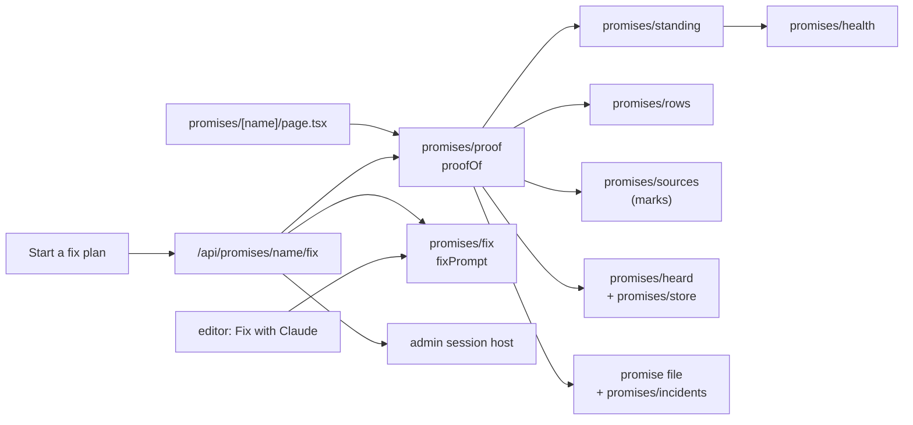

# The promise page

Every promise on the [dashboard](/reference/admin-ui/overview) opens its own page at `/p/<project>/promises/<name>`. The page answers one question: what proves this promise, and what is it doing now. It lays out what the package's `promises/proof` returns; the admin works out none of it.

## Sections

| Section | What it shows | Where it comes from |
|---|---|---|
| Banner | The standing as a chip (broken, being proven, declared, enforced), when it last broke, the symptom and trace link, and — when every test that names it passes — that the tests miss the case that breaks it. *Start a fix plan* appears here while it is broken, including a promise held open by an incident that no source reads red: its symptom and trace are the incident's. | `proofOf`'s `standing`, `broken` and `banner` |
| Tiles | Three `Stat`s: tests passing of total, and held and broke counted in days over the thirty UTC days ending today — a *held* day has an upheld run and no break, a *broken* day has a violation heard (five on one day are one), and a day nobody watched is neither, so the two need not add to thirty; a promise never seen shows none | `proofOf`'s `standing` |
| Tests that back it | Every test row, in any plan active or archived, that names the promise: its state and its test files | `promises/rows`, through `proofOf`'s `rows` |
| Where it is watched | Each service and operation the promise was marked at, and when it was last held and last broken; "not seen yet" when none | `promises/sources`' marks, through `proofOf`'s `marks` |
| Last thirty days | One bar per day for each source, red where a break was heard, green where it held | the recorder's `heard.jsonl` and the store, through `proofOf`'s `days` |
| Same plan | The other promises the owning plan owns | the registry |
| Where it lives | The promise file, its code sites and its tests | the registry |
| History | Declared, confirmed, changed and each incident, dated | the promise file's `## History` and `promises/incidents`, through `proofOf`'s `history` |

The page is drawn from components, as its approved mockups (`promise.broken`, `promise.enforced`) place them: the standing is a `Badge`, a broken promise's symptom, trace and *Start a fix plan* sit in an alert `DecisionCard`, the tiles are `Stat`s, the sections are `Box`es in a main column with *Same plan* and *Where it lives* beside it, and the history is a `Timeline`. The page passes each its data; it writes none of their markup. See [Components and stories](/guide/components).

A violation recorded while no admin page was open is on its day: the bars count what the recorder heard, not what a page saw.

## Start a fix plan

*Start a fix plan* posts to `/api/promises/<name>/fix`. The route refuses a promise that is not broken, then starts the developer's own `claude` in the owning plan's location (its worktree while it has one, else the project). Its first message is the package's `fixPrompt`: the promise, its symptom, a link to the trace and its tests. The editor's *Fix with Claude* uses the same function, so the two cannot word it differently. The session shows beneath the button; no terminal is used.

## How the page is built

