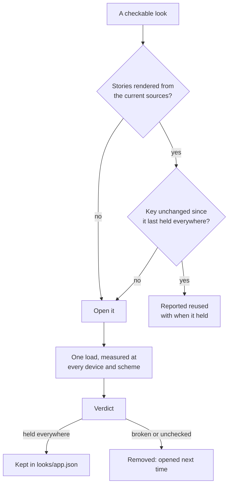

# `indusk looks`

An app's look, held the way a promise is held: mockups on one foundation of
design tokens, a rule that nothing in them or in the app is a raw value. The
design is [UI promises](/decisions/ui-promises).

## The foundation

Each app keeps its look under `.indusk/mockups/<app>/`:

```
.indusk/mockups/admin/
├── foundation.tokens.json   # the DTCG file every visual value comes from
├── devices.json             # the reference devices
├── screens.json             # the screens, their states, and the app's source directories
└── screens/home.empty.html  # one mockup per screen × state
```

`foundation.tokens.json` is a [DTCG 2025.10](https://www.designtokens.org/)
file. The types it may use are `color`, `dimension`, `fontFamily`,
`fontWeight`, `shadow`, `duration` and `cubicBezier`; a token of any other
type is refused by name. A token's CSS custom property is its path joined with
`-`: `space.3` is `--space-3`, `color.paper` is `--color-paper`.

A mockup that needs a token the foundation lacks declares it new, and only
then is it accepted:

```html
<meta name="indusk-new-tokens" content="--shadow-lift, --space-5" />
```

## `indusk looks lint <app>`

Reads the app's mockups and the source directories `screens.json` names, and
prints one finding per line:

```
src/Badge.jsx:3  p-[13px]  arbitrary-class — arbitrary value in p-[13px] — use a class from the foundation's theme
```

| Rule | What it names |
|------|---------------|
| `raw-value` | a colour, size, space, radius, border, shadow, font or motion value that is not a token — the declaration whole, and a literal anywhere inside it: behind a function (`rgb(255 0 0)`, `calc(13px * 2)`, a gradient's stops), in a `var()` fallback, or in a custom property a mockup defines without declaring it new or an app defines outside its generated file |
| `undefined-token` | `var(--x)` where the foundation defines no `--x` |
| `undeclared-token` | a mockup defines `--x` and neither the foundation nor the mockup's `indusk-new-tokens` meta has it |
| `redefined-token` | a mockup, or an app stylesheet other than the generated one, gives a foundation token a value of its own (`:root { --color-dusk: #ff00ff }`) — the foundation is the one place a value is approved |
| `external-reference` | a mockup reaches outside itself: a `<link href>`, an `@import`, an ``/`<script>`/`<iframe>` `src`, a `srcset`, a `poster`, or a `url()` that is not a `data:` URI or a `#fragment` — its approval binds only its own bytes. The generated `../tokens.css` is the foundation and passes |
| `stock-class` | a Tailwind colour, spacing step, radius, text size or shadow the foundation's theme does not define |
| `arbitrary-class` | a Tailwind arbitrary value such as `p-[13px]` |
| `duplicate-component` | one `data-component` name marked in two non-test, non-story files — `duplicate component badge: src/Badge.tsx, src/Other.tsx` |
| `component-outside-file` | when one of those files is the component's own by name (`Badge.tsx` for `badge`), every other file's marker — `component markup outside its file: src/Page.tsx:5 badge`: a screen writing the element out instead of rendering the component |
| `not-in-catalog` | a marked component the app's `components.json` omits (only when the app has a catalog) |
| `no-story` | a `<indusk-component name state>` in a mockup naming a state the catalog lists no story for — `no story: badge.warn` |
| `no-approved-story` | a `<indusk-component>` whose story has no snapshot, or one no person has approved as it is now — `no approved story: badge.warn`, at the reference's line |
| `content-not-words-or-components` | an element inside a `<indusk-component>` other than `<indusk-component>` or `<indusk-content>` — `content not words or components: <file>:<line> <div> inside button` |
| `component-takes-no-content` | content for a property the state's `content` in `components.json` does not list — `component takes no content: <file>:<line> button has no "label" to fill in state default` |
| `component-drawn-in-mockup` | a `data-component` element written in a mockup's source instead of placed by name — `component drawn in mockup: <file>:<line> badge` (only when the app has a catalog; a mockup `screens.json` lists as `uncomposed` is exempt) |
| `needs-a-story` | a notice, never a failure: a component the mockup declares new (`indusk-new-components`) that has no story yet — `needs a story: pill` |

**The properties held**: colour (`color`, `*-color`, `background`, `fill`,
`stroke`, `outline`), `margin*`, `padding*`, `gap`, `border` and each side and
width, `border-*-radius`, `width`, `height`, `inline-size`, `block-size`,
`inset*`, `top`/`right`/`bottom`/`left`, `outline-width`/`-offset`, `font` and
its size, family and weight, `line-height`, `letter-spacing`, `box-shadow`,
`text-shadow`, `transition*`, and an animation's duration, easing and delay.
A shorthand is judged by its longhands, so `border-left: var(--border-2) solid
var(--color-line)` passes. `min-*` and `max-*` sizes are not held yet — the
cockpit's reading measures (`70ch`) have no token.

**What passes**: `0`, `auto`, the CSS-wide keywords, `none`, `transparent`,
`currentColor`, a percentage, `vw`/`vh` (and `dvh`, `svh`, `lvh`, `vmin`,
`vmax`), `fr`, `min-`/`max-`/`fit-content`, and arithmetic on tokens
(`calc(100% - var(--space-4))`). A literal colour (hex or a colour function)
and a non-zero `px`, `rem`, `em`, `ms` or `s` do not, wherever they sit.

A mockup is read as the browser reads it (`parse5`): its `<style>` elements
and `style=""` attributes are its CSS, and a `<style>` inside a comment is not.

Exit 1 on any finding, 0 on none; a notice is listed and fails nothing. A
missing app or an unreadable foundation exits 1 naming the file; it is never a
clean app.

**Where each rule lives** (`src/lib/looks/`): the raw-value rule and the properties and units it holds in `lint-values`, the Tailwind class rules in `lint-classes`, the token checks (`undefined-token`, `undeclared-token`, `redefined-token`, `external-reference` in markup) and the orchestration in `lint`; a new rule gets a module of its own, not a place in `lint`.

## Composed mockups

A mockup shows a component by naming it, never by drawing it:

```html
<meta name="indusk-new-components" content="pill" />
…
<indusk-component name="badge" state="broken"></indusk-component>
<span data-component="pill">New</span>
```

Before a mockup is linted, shown on the Looks page, hashed for approval or
checked, `looks/compose` replaces each `<indusk-component name state>` with
that story's snapshot (`components/<name>.<state>.html`, written by
`indusk looks stories`); a missing `state` is `default`. So the component a
person approved is what every mockup shows, and a changed component changes
every mockup that places it. A mockup that names no component composes to its
own bytes.

The lint reads a composed mockup part by part: its source, located in its own
file, and each snapshot it composes, located in the snapshot's, so a finding
names a real line. A component drawn in a mockup's source is refused unless
the mockup declares it new in `<meta name="indusk-new-components">` — the
token rule (`indusk-new-tokens`) one level up — and a declared one is listed as
needing a story until it has one. A reference to a component or state with no
approved snapshot is refused.

A mockup's own `<style>` rules reach its page and never a component it
places: the cockpit scopes each selector of them to what is outside a component
(`:not(:where([data-component], [data-component] *))`, which adds no
specificity), so a mockup's `.grid { display: grid }` cannot change how a
placed card draws. A rule that names the component's marker
(`[data-component="card"] .grid`) is the mockup placing that component and is
left as written. A component the mockup declares new
(`<meta name="indusk-new-components">`) and draws itself is the exception: its
marker is left out of the scope, so the mockup's own styles still reach it,
since they are its only look. Each component's variant rules (under `@media`,
`@supports` or `@container`) load after every component's plain rules, as the
app's build orders them, so a hidden-on-a-phone class is not undone by another
component's `flex`.

`screens.json` may list `uncomposed`: mockups drawn before composition existed,
which still write their components out. They are exempt from `component drawn
in mockup` until rewritten, and the list only shrinks (the admin's eleven are
there until they are rewritten to compose their components).

## Approval

A mockup is the reference the app is held to only when a person has approved
it. The record is `.indusk/mockups/<app>/approved.json`:

```json
{
	"approvals": [
		{
			"mockup": "home.empty",
			"mockupHash": "3293523189dd…",
			"foundationHash": "ab91330460fb…",
			"declarationsHash": "65358e9c223f…",
			"by": "sandy",
			"at": "2026-10-10T09:00:00.000Z"
		}
	]
}
```

Each entry is bound to three sha256 hashes: the mockup's bytes, the
foundation's (`foundation.tokens.json`), and the **declarations** the check
trusts — the reference devices (`devices.json`), the `ignore` tags and the
`sources` (`screens.json`), read as key-sorted JSON so reformatting a file
binds the same. A mockup is **approved** while an entry holds all three
current hashes; otherwise it is **proposed**. So a change to an approved
mockup, to the foundation, or to a device's size, an ignored tag or the
source list returns it to proposed by itself, and an entry copied or typed
into the record with the wrong hashes approves nothing. An entry that binds no
declarations — every entry written before they were bound — reads proposed
until a person approves it again. Until a person approves the change, the app
is held to the last approved version on the foundation and declarations as
they are now, which `status` names.

An approval binds **what the person was shown**: Approve sends the hash of the
mockup the page drew and of the foundation it drew it on, and a mockup or a
foundation that changed since — on disk between the page's read and the
press — is refused, naming both hashes.

### Stories, and the components a mockup binds

A story is approved like a mockup, in the same record:

```json
{ "kind": "story", "story": "badge.ok", "snapshotHash": "e391c44c…",
  "foundationHash": "7adb7cf5…", "declarationsHash": "18e6e58b…",
  "by": "sandy", "at": "2026-10-12T09:00:00.000Z" }
```

It reads approved while an entry holds its snapshot's current hash on the
foundation and declarations as they are; a snapshot re-rendered from a changed
component reads proposed until a person approves it again.

A mockup that composes components binds them twice. Its `mockupHash` is the
hash of the **composed** mockup, so any change to what it shows reopens it.
Its entry also carries `componentsHash` — the sha256 of the snapshot hashes it
composes, one per story, sorted and joined by newline — and `components`, each
story with the snapshot hash it was approved with. When a component changes,
every approved mockup that composes it reads proposed and `status` names the
component (`component changed: badge`); a mockup that does not use it stays
approved. `components` only names what changed; the hashes decide. An entry
without `componentsHash` binds no component and holds only a mockup that
composes none, so approvals made before composition still stand.

`approve` refuses a mockup that composes any story not approved as it is now,
naming it — approve each story first — so approving a screen never approves a
component nobody looked at on its own. The cockpit sends a story's snapshot
hash (a story is refused without one) and a mockup's `componentsHash`, each
refused when the checkout now holds another.

### Why `approve` is the cockpit's

An agent can draw and propose a mockup; only a person approves one. The
approval is given in the cockpit, on the app's Looks page, with Approve — the
admin calls `approve` (and `withdraw`, for Unapprove) from
`@infinitedusky/indusk-mcp/looks/approve` with the person who pressed it, appends the entry, and commits the record on the branch
of the checkout the page showed — a plan's worktree commits on the plan's
branch, so the approval merges with the mockups it judges and never goes
through `main` — through the same notes writer the plan history uses, only
that file. Several proposed mockups can be selected and approved together:
each is its own entry, bound to its own hash, as the person who clicked.

What refuses every other way in:

- `indusk looks approve` exits 2 and writes nothing, naming the cockpit's
  Approve. A command an agent can run is not a person's approval.
- The `looks-approval-guard` hook refuses an agent's Write or Edit to any
  `.indusk/mockups/<app>/approved.json`, and an agent's Bash command that
  writes it — a redirect onto it, `tee`, `cp`/`mv`, `sed -i`, an interpreter's
  `-e`, `git checkout <ref> -- …` — or calls the approve route. It reads the
  path or the command's text, never the file.
- The approve route answers only the person's browser on the admin's own
  page: on top of the admin's host and origin check, it requires
  `Sec-Fetch-Site: same-origin`, which the browser sets and page script
  cannot, and which `curl` does not send.

**What this does not make impossible.** The hook is a tripwire for an agent's
ordinary attempt, not a boundary: a script that builds the path or the URL at
run time passes it, and a process running as the person can send any header.
Nothing on the person's machine can be made unforgeable by something running
as them. What holds past the tripwire is the record itself — an entry reads
approved only while its hashes are the mockup, foundation and declarations as
they are — and that the record is in git, where a forged entry is a visible
commit by whoever made it. A person editing the record by hand is theirs to
do, and it holds only when its hashes are true.

## `indusk looks tokens <app> [--tailwind] [--out <file>]`

The foundation as CSS: `:root` custom properties for a mockup, with dark-scheme
values (a token's `$extensions["dev.indusk"].dark`) under
`prefers-color-scheme: dark` and `[data-theme="dark"]`. With `--tailwind` it
writes an `@theme static` block that resets Tailwind's stock theme to the
foundation, so a stock class has nothing to compile to; a token in a mapped
group (`space`, `size`, `easing`) is written under Tailwind's name and the
foundation's own. `--out` writes the file, relative to the project root — an
app commits it beside its source (`apps/indusk-admin/src/app/foundation.generated.css`).

## `indusk looks status <app>`

One line per mockup, then one per story:

```
detail.default  proposed  never approved
home.default  proposed  component changed: badge — held to 81611821 (approved by sandy at 2026-10-12T09:00:00.000Z)
home.empty  approved  by sandy at 2026-10-10T09:00:00.000Z
home.full  proposed  held to 00000000 (approved by sandy at 2026-10-10T09:05:00.000Z)
story badge.broken  proposed  never approved
story badge.ok  proposed  changed since e391c44c (approved by sandy at 2026-10-12T09:00:00.000Z)
story card.default  approved  by sandy at 2026-10-12T09:00:00.000Z
```

A proposed mockup with an approved version names that version's first eight
hash characters: the reference the app is held to meanwhile — or, when that
version was approved on another foundation, other declarations or other
element rules, says `last approved … — nothing held`. Exit 0; a missing
app or an unreadable record exits 1 naming the file.

## `indusk looks coverage <app>`

Every part of the UI needs an approved mockup or, for a component state, an
approved story. Coverage reads the screens and
states `screens.json` declares, and the `data-component="<name>"` attributes in
the app's declared sources, and names what no approved mockup covers:

```
uncovered screen: detail
uncovered state: home.full
uncovered component: badge
unresolved component: src/Dynamic.jsx:2
unimplemented component: ghost
```

| Line | When |
|------|------|
| `uncovered screen: <name>` | none of the screen's declared states has an approved mockup |
| `uncovered state: <screen>.<state>` | the screen has an approved state, but not this one |
| `uncovered component: <name>` | the app renders it and no approved mockup shows it on an element |
| `unresolved component: <file>:<line>` | a source's `data-component={…}` is not a string literal, so no mockup can be said to cover it |
| `unimplemented component: <name>` | a held mockup (read composed) places or declares new a `data-component` that no non-test, non-story file in the app's sources marks. Held: every mockup whose latest approval names no plan or a landed (archived) one; a mockup re-approved by a plan still active keeps the components its landed approval recorded (all of them when that approval recorded none); a mockup only an active plan has approved is left out until it lands |
| `not in catalog: <name>` | a marked component missing from `components.json` (an app with no catalog reports none) |
| `no story: <name>.<state>` | a mockup places the state by name and the catalog lists no story for it |
| `uncovered story: <name>.<state>` | the app has the story's snapshot and no person has approved it as it is now — a component state is covered by its approved story |

Only a mockup approved as it is now covers anything, and only with an element
that carries the name: a mockup is parsed as HTML, so `data-component="badge"`
in its comment, script or style is text and covers nothing. A source's name is
read when written literally — `data-component="badge"`, `'badge'`, `{"badge"}`
— and listed `unresolved` when computed, never ignored. Exit 1 when anything is
uncovered or unresolved, 0 when every part is covered.

## `indusk looks stories <app>`

Renders every story of the app's Storybook to a snapshot and writes the
catalog an agent reads before it writes a component. Nothing needs to be
running; the step builds what it reads.

```
chip  apps/indusk-admin/src/components/ui/Badge.tsx  passing, blocked, skipped, planned, writable, written, unknown, neutral
admin: 8 snapshots for 1 components, catalog in .indusk/mockups/admin/components.json
```

```
.indusk/mockups/admin/
├── components.json              # the catalog: every component, its properties, its states
└── components/
    ├── chip.passing.html        # one snapshot per component state
    ├── chip.css                 # the app's compiled rules for that component's classes
    ├── _base.css                # the app's `body` rules (its type, ink and ground)
    └── _reset.css               # the app's element resets, scoped to components
```

A **snapshot** is the markup Chromium drew for one story, in the app's own
preview (its stylesheet and decorators), written to
`components/<name>.<state>.html`. The name is the `data-component` the story's
root element carries and the state is the story's id after `--`, so a story
`ui-badge--needs-you` of `badge` is `badge.needs-you`. A changed component
changes its snapshot with no edit to the story, which is what makes the
snapshot the component's approved artefact.

**`_reset.css`** is the app's element rules (rules that name no class and no
component marker: `a { color: inherit }`, `textarea { font: inherit }`, the
box-sizing and margin resets) cut from the compiled CSS. A story renders in the
served Storybook under those rules, and no component's own sheet holds them, so
without this sheet a component drawn in a mockup came out in the browser's
defaults: a blue link, a monospace text field. Every selector is written under
`:where([data-component], [data-component] *)`, which adds no specificity and
reaches only a component and what is inside it, so the page around a component
draws as before. Rules for `html`, `body`, `:root` and `:host` are left out
(`_base.css` holds `body`; a mockup's page is its own). The cockpit loads it
after the foundation's tokens, under every mockup and every story. It is not
part of an approval's `componentsHash`, as `_base.css` is not. An approval
binds it another way: the catalog keeps a hash of these rules (`baseRulesHash`)
and an approved story or mockup records the one it was approved under. When the
app's element rules change, every look is drawn differently in the cockpit, so
each approval that recorded the old hash reads proposed until a person approves
it again. A proposed look whose last approval was drawn under other element
rules is held to nothing, in the look check and in `looks status`, as one drawn
on another foundation is, until it is approved again. An approval made before
the hash was kept records none and reads as it always did.

`components.json` is `{ components: [{ name, file, properties[], states[] }] }`:
`file` is the component's one source file, `properties` are Storybook's
components manifest (name, type, whether required, default, description), and
each state is `{ name, snapshotHash }` — the sha256 of its snapshot file. An
app with no catalog reports no catalog gaps; one with a catalog reports each
marked component it omits (`not in catalog`), unless `screens.json` lists the
name under `uncatalogued`, the components marked before they have a story,
which only shrinks.

The step runs the app's own Vitest with the addon-vitest plugin over a
generated config in `node_modules/.cache/indusk-looks/`, so it needs the app's
`vitest`, `@vitest/browser-playwright` and a `build:storybook` script (the
components manifest is rebuilt first when it is older than a story or a
component). It refuses, exit 1 and by name:

- a marked name in two files — the scan's `duplicate component`;
- a story whose markup carries no `data-component`, or of a component no
  source marks;
- two stories of one component state;
- a story that did not render.

**The scan** (`looks/components`, `./looks/components`) is what `lint` and
`coverage` read and what the admin's `component-reuse-audit.test.ts` calls: a
name in one file is never a finding (a component not yet extracted from its
screen is the catalog's gap); a name in two is `duplicate component`, and when
one is the component's own file by name every other is also
`component markup outside its file: <file>:<line> <name>`.

## `indusk looks check <app> [--url <url>] [--only <look>...] [--all] [--changed <ref>]`

Holds the running app to what a person approved, by value, in a real Chromium.
`--url` is the app's base URL; without it the check uses `url` in the app's
`screens.json`, and with neither it refuses rather than guess. A screen is
opened at `<url><path>?state=<state>`, where `path` is the screen's own `path`
in `screens.json` and otherwise `/<name>`.
A screen may also give `page`, the file that draws it relative to the project root, for a route the app-router match does not find (`indusk looks check --changed` reads its imports from it); it is ignored unless a non-empty string.

For each declared screen state whose mockup is approved — or whose last
approved version was approved on the foundation and declarations as they are
now — at each device in `devices.json`, in each colour scheme, the check opens
the page and first asks it two questions:

- **Did it draw this state?** The page says which screen states it drew with
  `data-look-state` — a space-separated list of `<screen>.<state>` names, on
  `<html>` or on any element (several screens can share one page). A page that
  does not name the state is
  `unchecked … — the page did not report state <state>`, never held: a value
  check of a page that is not the state says
  nothing about the state. The cockpit reports `dashboard.default`,
  `dashboard.empty`, `looks.default` and `looks.uncovered`; its nav, promise
  and plan states are unchecked until it can.
- **Did it draw this scheme?** When any foundation token names a dark value,
  each look is opened in light and in dark (`colorScheme: dark`) and reported
  under `phone` and `phone/dark`. Dark is judged against each token's dark
  value. A page that pins itself light (`data-theme="light"`) when opened dark
  is `unchecked … @ phone/dark — the page did not render the dark scheme`.

**Stories.** Each approved story of `components.json` (or one held to its last
approved version on an unchanged foundation) is opened too, in the Storybook
the app's server serves at `/storybook`:
`<url>/storybook/iframe.html?id=<id>&viewMode=story`, at each device and
scheme (the story follows the page's `prefers-color-scheme`, which the check
switches). The story's id is the catalog's; a story with none is
`unchecked story <name> — no Storybook id in the catalog`, and an unapproved one
`unchecked story <name> — proposed, never approved`. A story's page reports no
state — the URL names it — so only the scheme is asked; the values are read from
the story's root (`#storybook-root`), not the frame around it. Reported
`held|broken story <component>.<state> @ <device>`, as a screen is.

**One load per look.** A look's page is loaded once, at the first reference
device and scheme. For every further device the check sets the page's size and
pixel ratio in place, and for every further scheme it switches the page's
colour scheme in place, then reads the values — so a look costs one page load
whatever the number of devices and schemes. A switch in place starts the
page's colour transitions, which a fresh load never does, so the check
finishes each running transition before it reads; a button is never read
half-way between two colours. A page that reads its size, pixel ratio or
colour scheme once when it starts, with nothing listening for a change, would
be read in place as it drew at the first device; the check notices such reads
and loads that page fresh at each device and scheme instead. Screens that need no seed open three at a time;
a screen with a `seed` opens alone.

**`--only <look>...`** checks just the named looks and reports nothing else.
A name is a screen state (`home.empty`) or a story (`badge.ok`); a name matches
the screen state and the story of that name alike. Repeat the option or
separate names with commas. A name no look of the app has is refused, naming
it, before any page opens. A named look is opened even when it could be
reused.

**An unchanged look is reused, not opened.** After a run, every look that held
at every device and scheme is kept with what it was held to and drawn from, in
the project's machine-state folder — `indusk eval home`'s folder,
`looks/<app>.json`, outside every checkout and the same from every worktree,
never committed. On the next run a look whose inputs are all unchanged is
reported from that result, without a browser opening it:

```
reused  home.empty — held 2026-10-16T03:00:00.000Z, unchanged
reused  story badge.ok — held 2026-10-16T03:00:00.000Z, unchanged
```

A look's inputs are the foundation (so a token change always reopens every
look), the checker itself (the properties it measures, the kinds it judges them
as, its measuring script and the verdict's version — so a release that measures
or judges differently reopens every look), the declarations, the devices and
schemes, and its snapshot hashes — a story's snapshot and stylesheet, a
screen's composed mockup and the components it composes — for a story the
app's element, universal and root rules it draws under (`a`, `h2`, `*`, `body`:
every compiled rule no class names, recorded at render as `baseRulesHash` in
`components.json`), and for a screen a hash of the app's page code (every file under
`sources` that is not a catalogued component's implementation, a story or a
test) and its seed, and the configuration a look is drawn with that no source
file holds: the app's Tailwind and PostCSS config, its `.storybook` folder and
the project's `pnpm-lock.yaml`. A look broken or unchecked at any device is not kept, so it
is always opened next time. A story's snapshot is only as new as the last
render, so `indusk looks stories <app>` records the sources it rendered from
(`renderedFrom` in `components.json`); when the sources have changed since,
nothing is reused and the check says to render the stories first. A screen
still drawn without composition (`uncomposed`) is never reused. A run where
every look was reused exits 0.



The build served at `--url` is checked against the sources, outside the key: the
same sources served by another build reopen the look. A server still on the
build from before the sources changed is told by a held look recorded on that
build with other sources: what it measures is reported but never kept held, a
look whose own inputs are unchanged is reused on the build it was measured on,
and the run says so:

```
http://localhost:3940 serves a build from before the sources changed — results were not kept; rebuild and serve it: pnpm --filter indusk-admin build && pnpm --filter indusk-admin start --port 3940
```

The build is read from the page's script and stylesheet
names (a production build names them by content hash); a page that cannot be
read within 30 seconds, or that loads nothing to tell by, reuses nothing, and
the check says so. A run writes only the looks it opened over the record as it
is when it writes, so two checks of one project never undo each other's
removals.
What a look reads that no input covers — the data a screen renders — is not in
the key. **`--all`** opens
every look whatever held: run it after a change the key cannot see, at a UI
plan's live check, and as the slow tests do after every landing and at every
release.

**`--changed <ref>`** opens only the looks a change touched, and reports every
other look from its last held result. The changed files are those committed
since the branch left `<ref>` (`git diff <ref>...HEAD`), modified in the working
tree, or untracked; the first line says how many looks they touch
(`changed since main: 27 of 181 looks touched`). A look is touched when a
changed file is one it is drawn from:

- **A screen** is drawn from its page, the `layout` files above it, and
  everything those import. The page is the screen's `page` in `screens.json`
  (a path from the project root) when it names one, else the Next.js app-router
  page its `path` (or the state's entry in `paths`) matches under the app's
  `app/` folder: a `[param]` folder matches any one segment, a `(group)` folder
  takes none, and the query string is ignored.
- **A story** is drawn from its component's file (the catalog's) and
  everything that imports.
- **Either** is also held to its mockup or snapshot, so a changed
  `screens/<screen>.<state>.html`, `components/<story>.html` or the component's
  stylesheet touches it.
- **Every look** is touched by a change to the app's foundation tokens,
  `devices.json`, `screens.json`, the generated stylesheet and the other
  stylesheets under `sources`, the Tailwind and PostCSS config, `.storybook`
  and `pnpm-lock.yaml`.

Imports are read with the app's own TypeScript (`typescript` loaded from the
app's folder, with the app's `tsconfig` paths), staying inside the project. When
the app has no TypeScript to load, or a screen's page cannot be found, what a
change reaches cannot be told, so any change touches every look: the check
over-reports and never under-reports. A touched look is opened on every device
and scheme it is drawn for; an untouched look with a held result is reused
**even when its key changed** (a page edit moves every screen's key, which is
why `--changed` exists). An untouched look that was never held still opens,
since there is nothing to report for it. `--all` and `--only` win over
`--changed`.

**A development server is refused.** Before any look opens, the check reads the
page at the base URL's own path (and the first story's frame) over plain HTTP
and looks, in the scripts and stylesheets it loads — never in its text, which
carries the page's data — for the code a development server adds: Next's
live-reload client (`hmr-client`), webpack's refresh runtime (`react-refresh`)
and Vite's client (`/@vite/client`). One found ends the run with exit 1 before a look
opens, naming the command that builds and serves the app:

```
http://localhost:3961 is a development server (hmr-client) — build and serve the app, then check again: pnpm --filter indusk-admin build && pnpm --filter indusk-admin start --port 3940
```

That command is the optional `serve` entry of the app's
`.indusk/mockups/<app>/screens.json`; with none declared the message says how to
declare one. It is not part of the declarations an approval binds, so declaring
it reopens nothing. A development server compiles each route on first request,
which once made a check of the admin take half an hour.

Then it decides two things:

| Check | Held when | A broken line names |
|-------|-----------|---------------------|
| Tokens | each foundation token read from `:root` equals its approved value | the token, approved and actual |
| Elements | each element's colour, length, radius, shadow, font, `transition-duration` and `transition-timing-function` is one of the approved values of its kind | the element, the property, the actual value and the nearest token |

A token changed in the app alone breaks the token and, through every element
that uses it, each of those elements. A duration or an easing is held to its
approved value like a colour or a size. The browser's own initial values — a
zero length, no shadow, no transition, a transparent background — are never a
break.

```
held    home.empty @ phone
broken  home.empty @ desktop
  token --color-dusk approved #c2620b actual #c2620c
  element button.primary background-color actual rgb(194, 98, 12) nearest --color-dusk (#c2620b)
unchecked home.full @ phone — the page did not report state full
unchecked detail.default — proposed, never approved
admin: 12 looks held, 0 reused, 54 unchecked
```

Elements the check does not draw are named in `screens.json`'s `ignore` (tag
names, such as `nextjs-portal` in development); a margin of `auto` is read as
the keyword, not the pixels it resolved to; a shadow is read layer by layer, in
whatever colour spelling, and a framework's empty layer is not a break.

A proposed mockup is not checked against (`unchecked`, with the reason). A look
whose page answers 404 is `unchecked` too, naming the 404 (`… answered 404 — not
in this project`) and the run goes on: the plan and brief screens open at
fixture plans only the contract test's project holds, so a check against your
own project names them unchecked. A page that fails any other way (a 500, a
refused connection) still ends the run. The closing line counts reused and
unchecked looks beside held and broken (`admin: 12 looks held, 40 reused, 2
unchecked`). Each look is
also recorded as a span, one per screen × state × device and scheme, carrying a
signal for `tokens-are-held-exactly` — `upheld` when held,
`violated` (read as broken) with the first finding as the symptom when broken — so a look reads
beside promises in the health reader. A story's span carries
`indusk.look.kind = story` beside `indusk.look.app`, `screen`, `state` and
`device` (the screen is the component's name); a screen's span carries no
`kind`. A look's standing counts only runs of its own kind, so a held story
`nav.expanded` never stands for a broken screen `nav.expanded`; a run recorded
without `kind` reads as a screen's. A reused look sends one upheld span per
device and scheme too, marked `indusk.look.reused = true` with
`indusk.look.measured_at`, the time it was really measured: its standing keeps
reading holding run after run, and a reader can always tell it from a fresh
measurement, which carries neither.

Exit 1 on any broken look, and when nothing was checked or reused: a run that
checked nothing is not a held look. `playwright-core` is an optional
dependency; without it, or without Chromium, the command refuses by name and
says what to install. Because it opens a browser it runs in the system tier,
never in the everyday suite.
