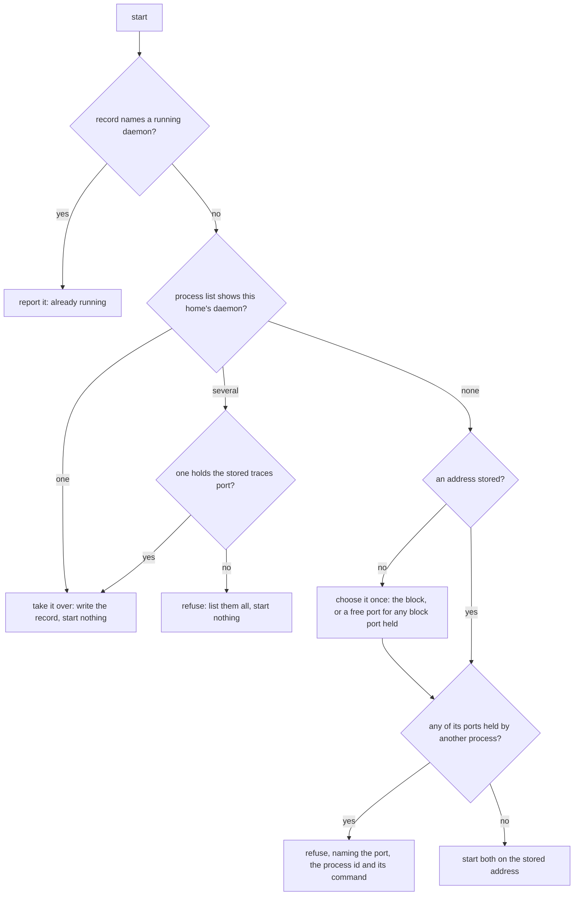

# Local Telemetry — CLI Reference

The `indusk telemetry` subcommand manages the local telemetry daemon (Jaeger + OTel Collector core) on your machine. The daemon is machine-global — one set of processes serves every registered InDusk project on the machine.

Available since indusk-mcp **1.28.0**.

## Quick reference

```
indusk telemetry start      # Start the daemon on its stored address, or take over the one running
indusk telemetry stop       # Stop the daemon
indusk telemetry restart    # Stop then start, on the same stored address
indusk telemetry status     # Report state + the four ports + PIDs
indusk telemetry reap       # Stop this home's strays (--dry-run lists them)
indusk telemetry address    # Print the stored address (--json for init, --reset to choose again)
```

Query subcommands (`tail`, `trace`, `services`, `reset`) — see [Query subcommands](#query-subcommands) below.

## `indusk telemetry start`

Start the telemetry daemon (Jaeger + otelcol), or take over the one already running. Spawns both binaries as detached child processes that survive terminal close. Writes daemon metadata to `~/.indusk/telemetry.{pid,json,log}`.

```sh
indusk telemetry start
```

The daemon runs on **one address per machine**, chosen once the first time it is set up and kept in `~/.indusk/telemetry-address.json`. See [the stored address](#the-stored-address) below. `start` takes no port options in your own home: the address is already decided.

**What `start` does**, in order:



- **Taking over.** If the record is lost but the daemon runs, `start` reads it from the process list and its listening sockets, writes the record again and starts nothing: `took over the running daemon: jaeger 43599, otelcol 43600 on 24318, 24319, 24316, 24317`. Any other InDusk Jaeger or collector of this home is listed as a stray for `indusk telemetry reap`.
- **Refusing.** Once the address is stored, a start that finds one of its ports held by a process that is not InDusk's starts nothing, picks nothing, leaves the address as it was and exits `1`, naming the port, the holder's process id and its command.
- **An unreadable address file.** A file that exists but is cut short, or names a port that is not a number, is never taken for a missing one: a start refuses, naming the file, chooses nothing and leaves it as it was. `indusk telemetry address --reset` chooses the address again. The address is always written whole (a temporary file, then a rename), so a crash never leaves it half-written.

**Port options** (`--otlp-port`, `--ui-port`, `--logs-port`, `--mcp-port`) are accepted only in a temporary home (a test's, under the system temp directory). A temporary home takes the ports it is given (`0` means any free port) and never reads or writes the stored address. In your own home they are refused by name.

**Exit codes**: `0` on success (started, taken over, or already running), `1` on a refusal or a spawn failure. Failure reasons include a port held by another process, platform package not installed, or Jaeger or otelcol not becoming ready on its health port within 15s.

**Sample output**:

```
Telemetry daemon started:
  OTLP:      http://localhost:24318
  Logs:      http://localhost:24319
  Jaeger UI: http://localhost:24316
  Jaeger MCP: http://localhost:24317
  PIDs:      jaeger=72113 otelcol=72117
  Logs file: ~/.indusk/telemetry/logs.jsonl
```

### The stored address {#the-stored-address}

| Role | InDusk's block |
|------|----------------|
| traces (OTLP HTTP) | `24318` |
| logs (OTLP HTTP) | `24319` |
| interface (Jaeger UI) | `24316` |
| MCP (`jaeger` MCP server) | `24317` |

The first time the daemon is set up on a machine, the address is chosen: InDusk's block, except that a block port held at that moment by a process that is not InDusk's is replaced by a free port picked once. `start` prints which port was held, by what, and the port it picked in its place. The result is stored and **never changes** afterwards: every start, restart and automatic start (by `init`, `update` or enabling the extension) uses it, and the same four ports come back after a stop, a restart, or a record lost and found again.

The standard `4318` is left to your other tools on purpose: InDusk's daemon does not take it, so another collector of yours can keep it.

### `indusk telemetry address`

Print the stored address, for you or for `init` to hand to an application:

```sh
indusk telemetry address            # traces, logs, interface and MCP URLs
indusk telemetry address --json     # the same as JSON
indusk telemetry address --reset    # choose again, by the same rule
```

With no address stored it says so and exits `1`; with an address file it cannot read it says that instead, naming `--reset`; it chooses nothing. `--reset` is the **only** way the stored address ever changes: it keeps any port this home's running daemon holds, prints the old and the new address, and reminds you that every application given the old address needs the new one. The running daemon moves onto the new address at the next `restart`.

## `indusk telemetry stop`

SIGTERM both daemon processes (Jaeger + otelcol). Polls for exit up to 3 seconds; if either process hasn't exited, SIGKILLs the survivors. Cleans up `~/.indusk/telemetry.pid` + `~/.indusk/telemetry.json`.

Identity gate: if the recorded PIDs don't verify (not alive OR not listening on recorded ports — i.e., PID-reuse after crash), the daemon reports "stopped" without SIGTERM'ing the PIDs (avoids killing a stranger's process that inherited the recycled PID).

**Sample output**:

```
Telemetry daemon stopped (jaeger=72113 otelcol=72117).
```

Or, if SIGKILL was required:

```
Warning: Telemetry daemon (jaeger=72113 otelcol=72117) did not exit within 3s; forced with SIGKILL.
```

## `indusk telemetry reap`

Stops every **stray** of this home: a Jaeger or collector run out of this home's config files that the record does not name, whether its config file still exists or not. A lost record is how they appear, when a start that did not know the daemon was running started another beside it. `reap` never touches the recorded daemon, a daemon of another home (a test's, for one), or a process that is not InDusk's; each process is read again by its command line just before it is signalled, so a process id the operating system has since given to another program is left alone.

With no record, nothing is known to be the daemon, so `reap` stops nothing and says to run `indusk telemetry start` first, which takes the running daemon over.

```sh
indusk telemetry reap --dry-run   # list the strays, signal nothing
indusk telemetry reap
```

```
Strays of this home (2):
  stopped jaeger 60107
  stopped otelcol 60109
```

A stray that does not stop within three seconds is sent SIGKILL; one that still does not stop is named (`jaeger 60107 would not stop; stop it by hand`) and the exit code is non-zero.

## `indusk telemetry restart`

Equivalent to `stop` + waiting for the OS to release the ports + `start`, **on the same stored address** (a temporary home comes back on the ports it held). A daemon started before the address was stored, on other ports, is moved onto it by a restart; `status` says which ports differ. Picks up new binaries after `npm i -g @infinitedusky/indusk-mcp@<newer>` triggers a platform-package refresh — the daemon's next spawn uses the newly-installed binaries.

This is the load-bearing post-upgrade flow: `start` is intentionally idempotent (no-op on running daemon), so `restart` is how you cycle in fresh binaries.

```sh
indusk telemetry restart
```

Re-pointing project files: a restart on the stored address keeps the MCP port, so no project's `.mcp.json` is touched. Only an entry that names exactly the old MCP port is re-pointed, when the port changed.

## `indusk telemetry status`

Report current daemon state. The recorded Jaeger and otelcol are judged by their command lines (see [what counts as InDusk's daemon](./overview#what-counts-as-the-daemon)), never by a port, so a recycled process id is not "running" and a slow port is not "gone". Reading never removes the record. Five states:

| State | Meaning |
|-------|---------|
| running | the record names both processes and both are InDusk's daemon |
| partly running | only one of the two is still the daemon; `stop` then `start` |
| record missing | no record, but this home's daemon processes run |
| not running, record kept | the record names processes that are gone or are something else now; it is named and left for `start` to overwrite and `stop` to remove |
| not running | no record and nothing runs |

If the log holds lines of Jaeger failing to trace itself since the daemon started (a daemon started before its own tracing was switched off), status prints their count and the first of them and says `restart` starts it quiet.

Each port is also asked once. A port that does not answer in time prints `:<port> did not answer in <ms> ms (slow, not gone)`; one that refuses prints `:<port> refused (starting, or that receiver failed)`. Any InDusk Jaeger or collector of this home that the record does not name is listed as a stray, with its process id, start time, ports and install, and `indusk telemetry reap` stops them.

**Running output**:

```
Telemetry daemon: running
  OTLP:      http://localhost:24318
  Logs:      http://localhost:24319
  Jaeger UI: http://localhost:24316
  MCP:       http://localhost:24317
  PIDs:      jaeger=72113 otelcol=72117
  Started:   2026-04-20T22:45:00.000Z
Registered projects 0 (registry lands in Phase 4)
```

**Not-running output**:

```
Telemetry daemon: not running
Registered projects 0 (registry lands in Phase 4)
```

## Query subcommands

Once the daemon is running, four query subcommands provide human-readable access to the data otelcol + Jaeger have collected. Each one targets a different signal, so the command you reach for depends on what you're looking for:

| Subcommand | Target | Backend |
|------------|--------|---------|
| `tail`     | log records | otelcol's file sink (`~/.indusk/telemetry/logs.jsonl`) |
| `trace`    | a single trace's span tree by ID | Jaeger REST (`/api/traces/<id>`) |
| `services` | list of services that have emitted spans | Jaeger REST (`/api/services`) |
| `reset`    | wipe in-memory trace storage + log sink | daemon lifecycle |

Agent-facing equivalents exist as MCP tools wherever the signal maps cleanly (see `tail_logs` for logs, and the bundled `jaeger_mcp` extension for traces — exposed as the `jaeger` MCP server in every registered project's `.mcp.json`).

### `indusk telemetry tail`

Print recent log records from the file sink, filtered by service, level, and lookback window. The same filter shape as the `tail_logs` MCP tool, but human-formatted as `ISO [LEVEL] service message` lines instead of JSON.

```sh
indusk telemetry tail [--service <name>] [--level <level>] [--since <minutes>] [--limit <n>]
```

**Flags:**

- `--service <name>` — filter by `service.name` resource attribute. Exact match. Omit to see all services.
- `--level <level>` — minimum severity: `error` / `warn` / `info` / `debug` / `any`. Default `any`. `warn` means "warn and above" (i.e., also `error`).
- `--since <minutes>` — how far back to look. Default `5`. Capped at 240 for the MCP tool; the CLI has no hard cap but the sink is bounded at 50 MB.
- `--limit <n>` — max records to print. Default `50`. If more records match than `limit`, the CLI prints the most recent `n` and reports how many were elided.

**Sample output**:

```
2026-04-20T22:46:10.123Z [ERROR] indusk-mcp           Failed to reach the collector: ECONNREFUSED
2026-04-20T22:46:11.445Z [INFO ] indusk-mcp           Retrying in 500ms
...
(showing last 50 of 87 matching records — raise --limit to see more)
```

**No-match output**: `No log records in the last 5 minute(s) for service=indusk-mcp at level>=warn.` No exit-code failure — "nothing happened in your window" is a normal result.

**Empty sink**: `No log sink yet. Emit some logs or start the daemon.` — exits `0`. The file is created lazily by otelcol on the first log record received.

### `indusk telemetry trace <id>`

Fetch a single trace's full span tree from Jaeger via its REST query API (`/api/traces/<id>`). Prints the raw JSON response (one root + all descendant spans with timing + attributes).

```sh
indusk telemetry trace <trace-id>
```

Use this for debugging a specific trace the agent or your own code has already surfaced (e.g., an eval-agent scorecard that referenced a trace ID, or a log line with a correlation ID). To browse for traces interactively, use the Jaeger UI at `http://localhost:{ui-port}` — the UI is the right tool for trace discovery; `trace <id>` is the right tool for drilling into a known one.

**Exit codes**: `0` on success, `1` if the daemon isn't running or Jaeger returns non-2xx.

### `indusk telemetry services`

List every service that has emitted at least one span, one per line. Backed by Jaeger's `/api/services`.

```sh
indusk telemetry services
```

**Sample output**:

```
indusk-mcp
admin-ui
numero-api
```

**No services yet**: prints `(no services have emitted traces yet)` — exits `0`. Common when you've just started the daemon and haven't run anything that emits OTel.

### `indusk telemetry reset`

Wipe the daemon's in-memory trace storage and truncate the log sink file. Equivalent to `stop + truncate ~/.indusk/telemetry/logs.jsonl + start`. Useful when you want a clean slate before reproducing an issue — e.g., you want the next `tail` to show only records from this run.

```sh
indusk telemetry reset
```

**Not exposed as an MCP tool** — it's a human-triggered clean-the-slate action. An agent that thinks it needs this almost certainly needs a narrower `tail --since 1` or a specific `trace <id>` instead.

**Ports**: the daemon comes back on the same address (port options exist only in a temporary home, as for `start`).

**Sample output**:

```
Stopping daemon + clearing buffers...
Daemon restarted with fresh buffers.
  OTLP:      http://localhost:24318
  Logs:      http://localhost:24319
  Jaeger UI: http://localhost:24316
  Jaeger MCP: http://localhost:24317
```

## Daemon files

| Path | Purpose |
|------|---------|
| `~/.indusk/telemetry.pid` | Jaeger's PID (primary process). Read by `status`/`stop` for the liveness probe. |
| `~/.indusk/telemetry.json` | Full metadata — both PIDs, all ports, start time, binary paths, platform, log path. |
| `~/.indusk/telemetry.log` | Interleaved stdout + stderr from Jaeger + otelcol. First place to look when diagnosing a spawn failure. |
| `~/.indusk/telemetry-jaeger.yaml` | Jaeger config rendered with auto-picked ports. Inspectable but regenerated every `start`. |
| `~/.indusk/telemetry-collector.yaml` | otelcol config rendered with auto-picked ports. Inspectable but regenerated every `start`. |
| `~/.indusk/telemetry/logs.jsonl` | Structured logs received by otelcol, rotating file (10 MB × 5 backups = 50 MB buffer). |

## Environment variables

- `INDUSK_HOME` — overrides the default `~/.indusk/` root. Used primarily by tests to isolate daemon files from a developer's real setup. If you set it, all the above paths root under it.
- `INDUSK_SKIP_TELEMETRY_AUTOSTART=1` — `indusk telemetry register` (run by the extension's `on_enable`, so by every `init` and `update`) still registers the project but does not start the daemon when none is running; it says so. Set by this repository's everyday test configs: every test that ran `init` against a temporary `INDUSK_HOME` used to leave a detached Jaeger + otelcol pair running — 860 of them on 2026-10-03. `pnpm test` and `pnpm test:system` both end with `apps/indusk-mcp/scripts/check-test-daemons.js`, run through `with-daemon-guard.js` so it runs whether the tests passed or failed; it fails naming any telemetry process still running from a temporary home after a five-second grace. Never set it in a shell you use the CLI from: a project registered without a running daemon has nowhere to send its traces.

## See also

- [Overview](./overview) — architecture diagram, MCP tool surface, env routing, migration from Dash0-only.
- ADR: `.indusk/planning/archive/local-telemetry/adr.md` (source-of-truth architectural decision).
- Spike findings: `.indusk/planning/archive/local-telemetry/spike-findings.md` (Phase 1 measurements + binding decisions).
