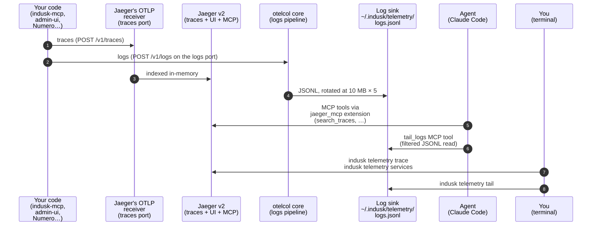
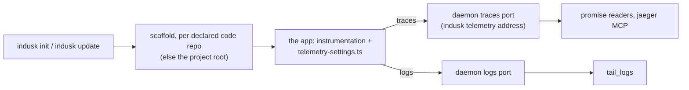

# Local Telemetry — Overview

Local telemetry is a **required-by-default** InDusk extension that turns your own machine into the dev-environment observability backend. While your code is running locally, OTel traces and logs emit to the daemon's own address (`localhost:24318` for traces, `24319` for logs) where a machine-global daemon (Jaeger v2 + OTel Collector core) absorbs them; the agent queries them through MCP tools; you query them through `indusk telemetry *` subcommands.

Available since indusk-mcp **1.28.0**.

This page is the architectural orientation. For the runnable surface, see the [CLI reference](./cli).

## Why local telemetry exists

Before 1.28, the only OTel destination scaffolded by `indusk init` was [Dash0](https://dash0.com). That's the right answer for staging + production — a hosted backend, durable storage, cross-team dashboards. But it's the wrong answer for the inner dev loop:

- **Cost**: every run emits spans that bill against your Dash0 quota.
- **Latency**: a span crossing the public internet + Dash0's ingest pipeline takes seconds to become queryable.
- **Trust boundary**: you're shipping dev traffic, including accidental PII in debug logs, to a third party.
- **Agent access**: the agent can't poll Dash0 cheaply enough to use it as a diagnostic substrate.

Local telemetry fills the gap. One daemon runs on your machine, every InDusk project on that machine emits into it, and both you and the agent query it directly. Staging + production OTel still route to Dash0 — only the `development` profile is redirected.

## The daemon model

One machine. One set of processes. Every registered project emits into them.



**Key structural facts:**

- **Machine-global**: one daemon process set serves every registered InDusk project. Projects register at extension-enable time; the daemon auto-starts on first register and auto-stops when the last project deregisters.
- **Native binaries, not containers**: Jaeger and otelcol ship as platform-specific npm packages (esbuild/swc pattern — see [Platform packages](#platform-packages)) and launch as detached child processes. The daemon metadata lives at `~/.indusk/telemetry.{pid,json,log}`.
- **Two children, one CLI**: `daemon.ts` supervises both Jaeger and otelcol. `start/stop/restart` act on both atomically; `status` reports both PIDs.
- **Trace storage is ephemeral**: Jaeger v2's in-memory backend, capped at 100k spans. Retention is "until the daemon restarts or the ring buffer wraps." Good enough for inner-loop debugging; not a substitute for Dash0.
- **Log storage is an append-only JSONL file**: otelcol writes OTLP-envelope logs to `~/.indusk/telemetry/logs.jsonl`, rotated at 10 MB × 5 backups = 50 MB buffer total. Reset by `indusk telemetry reset`.

## The daemon's ports {#the-daemons-ports}

The daemon has **one address per machine**, chosen once at first setup and stored in `~/.indusk/telemetry-address.json`. InDusk never moves it on its own: every start, restart and automatic start uses it, and only `indusk telemetry address --reset`, run by a person, chooses it again.

| Role | Port | What reaches it |
|------|------|-----------------|
| traces | `24318` | applications' span exporters (OTLP HTTP) |
| logs | `24319` | applications' log exporters (OTLP HTTP) |
| interface | `24316` | Jaeger's UI and query API |
| MCP | `24317` | the `jaeger` MCP server in each project's `.mcp.json` |

If another program holds one of these at the moment of first setup, a free port is picked once for that role instead, and the start says which. A port picked is stored like the rest. Once the address is stored, a start that finds one of its ports held by a stranger refuses, naming the port and the process; it never moves a port on its own. `indusk telemetry address` prints the address (`--json` for `init` to hand to an application), and `--reset` is the only way to choose again.

InDusk's daemon deliberately does not take the standard `4318`: that port is left to a person's other tools, and an application is handed the daemon's own traces port instead. A recording server (`telemetry serve` on Fly) is a dedicated machine and keeps the standard ports there.

## What counts as InDusk's daemon {#what-counts-as-the-daemon}

A process is InDusk's daemon of a home when it runs InDusk's shipped Jaeger or collector binary (the `telemetry-binaries-<platform>` package) with its `--config` file in that home. Nothing else decides it: not a port answering (a busy reader sees a healthy port as slow), not a start time, not the binary file still existing. A daemon started in a temporary home belongs to that home and is never taken for the machine's own.

The **record** is `~/.indusk/telemetry.json` (with `telemetry.pid`): the two process ids, the ports, the start time. It is a note about the daemon, not the daemon. A status read never removes it: only `indusk telemetry stop` does, and `start` writes over one whose processes are gone.

### A lost record is found

When the record is gone, or names only dead processes, and the daemon still runs, the next command that looks finds it. It reads the process list for this home's Jaeger and collector, reads the ports each one really listens on from the operating system (`lsof`, or `/proc` on Linux when `lsof` is missing), pairs them (a Jaeger holding the stored traces port with the collector holding the stored logs port first, then by start time), and writes the record again (removing a dead record first, under the lock), with an exclusive create under `~/.indusk/telemetry.lock` so that only one command writes when several look at once. A port is never guessed: a role whose port no socket or rendered config file can name is left unknown and said so. When several daemons of the home run, it takes the one holding the traces port and leaves the others for `status` to list as strays. Every reader of the local daemon (`promises status` and `watch`, the promise health tool, the admin, the evaluator, `update`, `demo`, `telemetry reset`) asks the same resolver, so none of them can disagree about whether a daemon runs.

## The promise's signal {#the-promises-signal}

The daemon is held by a promise, `the-daemon-readers-follow-is-the-one-running`: every reader of promises, every InDusk command and every application on a machine reaches the same one local daemon. Its six parts each have a signal, and the signal is a span the running daemon itself receives, sent by the InDusk command that knows the answer at the moment it knows it. They are sent as the service `indusk-telemetry`, not as the watcher's `indusk-watcher`: the watcher's probe is frequent, and mixed in with it these reports would fill the 1,500 traces a query reads and push a broken one out of sight. A report is posted straight to the daemon's traces port, only after the daemon is confirmed to be InDusk's, and is dropped if the daemon does not take it in about two seconds; a report never holds a command and never fails one. Reports from telemetry commands carry no project; a promise reader's carries the project it read for.

| Part of the promise | Who sends it, and when | Upheld when | Broken, and what it says |
|---|---|---|---|
| `one-daemon-on-its-own-ports` | `telemetry status` when the daemon is running, or partly running while its Jaeger is alive to receive it; `start` and `restart` once the daemon is ready; a takeover | one InDusk Jaeger and one collector hold the four ports of the stored address | another InDusk daemon runs beside it (each by process id, start time and ports), or a stored port the daemon does not hold (naming the port it holds instead), or a recorded process that has stopped (naming it and the ports it no longer holds) |
| `a-read-never-loses-the-daemon` | upheld: a promise reader (`promises status`, `watch`, the promise health tool, the admin) when it reached the daemon through an intact record, at most once per project every 15 minutes. Broken: whichever command finds a lost daemon and writes the record again | a reader reached the daemon through its record | the record was missing while a Jaeger ran, naming that Jaeger and the command that found it. A loss is reported when it is found, not when it happens |
| `a-lost-daemon-is-found` | the command that found the daemon, after it writes the record; every `start` or `restart` that launched a daemon, once ready | a lost daemon was found and its record rebuilt, or a start had nothing beside it | a start found another InDusk daemon beside the one it just started |
| `nothing-starts-a-second` | `register`, at its end | no second InDusk daemon, and no other project's `.mcp.json` entry changed | a second daemon, or another project's entry changed (path, old address, new address). A refused register sends nothing |
| `strays-are-cleared` | `telemetry reap`, at its end, to the recorded daemon; nothing when there is none | no stray remains | each stray still running |
| `the-log-is-readable` | `telemetry status` when the daemon is running | no line of Jaeger failing to trace itself since this daemon started | the count of such lines and the first |

Every broken report opens with the part's name, so a reader can tell which part broke. Three parts report only when someone runs a telemetry command (`the-log-is-readable`, most of `one-daemon-on-its-own-ports`, `strays-are-cleared`), so between runs they read as no signal. A partly running daemon (a collector that has died beside a live Jaeger) is reported broken by `status`; with the Jaeger gone too there is nothing to receive it. A start refused because a stranger holds a stored port, or because the address file is unreadable, sends nothing, because no InDusk daemon is there to receive it. A slow port misread as gone, with the record untouched, also sends nothing. The reports are live telemetry: a test run produces none of them, and only a running daemon proves one arrives.

## Jaeger v2 is an OTel Collector distribution

The load-bearing discovery from the Phase 1 spike: Jaeger v2 is **implemented as an OTel Collector distribution**. A single binary bundles:

- `otlp` receiver (OTLP HTTP/gRPC)
- `batch` / `memory_limiter` / `filter` / `tail_sampling` processors
- `jaeger_storage_exporter` (in-memory or Badger backend)
- `jaeger_query` extension (REST API + UI on the interface port)
- `jaeger_mcp` extension (agent-facing MCP tools — see below)
- `healthcheckv2` extension (on an internal port picked at start)

So the "Jaeger vs OTel Collector" framing is wrong. There's one binary that does both — it IS the Collector. That collapsed what Phase 1 thought would be a two-binary-per-trace-path setup into one child process for traces.

Where the second binary (`otelcol` core, 168 MB) still earns its spot: **logs**. Jaeger v2 doesn't ship a file/SQLite log exporter, so the logs pipeline runs through a plain otelcol instance that terminates in a `file` exporter writing JSONL to the sink. Queried via the custom `tail_logs` MCP tool + `indusk telemetry tail` CLI — see the [Agent + human surface](#agent-human-surface) section.

## Platform packages

Binaries ship as **platform-specific npm optional dependencies** — the pattern used by esbuild, swc, and Biome. Upstream Jaeger + otelcol release tarballs are fetched at build time, SHA-verified against the upstream checksum files, and packed into one npm package per `(os × arch)` combination:

| Package | Platforms | Size (uncompressed) |
|---------|-----------|--------------------|
| `@infinitedusky/telemetry-binaries-darwin-arm64` | macOS Apple Silicon | ~282 MB |
| `@infinitedusky/telemetry-binaries-darwin-x64` | macOS Intel | ~282 MB |
| `@infinitedusky/telemetry-binaries-linux-arm64` | Linux arm64 | ~282 MB |
| `@infinitedusky/telemetry-binaries-linux-x64` | Linux x64 | ~282 MB |

`apps/indusk-mcp/package.json` lists all four as `optionalDependencies` with matching `os`/`cpu` constraints. When a consumer runs `npm i -g @infinitedusky/indusk-mcp`, npm installs **exactly one** platform package — the one matching their machine. Other platforms' packages are skipped cleanly (not downloaded).

The daemon resolves binaries via `createRequire(import.meta.url).resolve("@infinitedusky/telemetry-binaries-{platform}/bin/jaeger")` at `start` time. If the platform package is missing (unsupported OS/arch, or `optionalDependencies` failed to install), `start` fails with a specific error message pointing at the missing package.

**Upstream pins**: `packages/telemetry-binaries-shared/UPSTREAM.json` names the upstream versions (Jaeger v2.17.0 + otelcol core v0.150.1 at 1.28.0 ship). Bumping binaries = edit `UPSTREAM.json`, re-run `scripts/build-telemetry-binaries.sh`, bump the platform packages' version, bump indusk-mcp's `optionalDependencies` pins, publish. Consumer upgrade path: `npm i -g @infinitedusky/indusk-mcp@<newer>` + `indusk telemetry restart`.

## Extension wiring

`local-telemetry` is a **required-by-default** extension (`required: true` in its `manifest.json`). Every `indusk init` scaffolds it; every `indusk update` on a pre-1.28 project adds it as a migration step.

**Enable-time** (`indusk extensions enable local-telemetry` or `indusk init` on a fresh project):

1. Writes no environment file: an app reaches the daemon through the settings file `init` scaffolds into it (see [what a project is handed](#what-a-project-is-handed)), with nothing set.
2. Calls `indusk telemetry register $(pwd)` — appends to `~/.indusk/telemetry/projects.json`, takes over the running daemon or starts the one daemon on its stored address (choosing the address first if none is stored; never a second daemon), and upserts a `jaeger` MCP server entry in **this project's** `.mcp.json` pointing at the stored MCP port. The file is rewritten only when the entry differs, and no other project's entry is touched.
3. The `.mcp.json` entry follows the same shape as the `dash0` extension's — a plain `{ type: "http", url: "http://localhost:{mcpPort}/mcp" }` block. Claude Code loads it on the next session start.

**Disable-time** (`indusk extensions disable local-telemetry`):

1. Removes the `jaeger` MCP server entry from `.mcp.json`.
2. Calls `indusk telemetry deregister $(pwd)` — removes the project from the registry.
3. If the registry becomes empty, gracefully stops the daemon. Otherwise the daemon keeps running for the other registered projects.

**Escape hatch**: if you don't want local telemetry on a specific project, add `disabled_extensions: ["local-telemetry"]` to `.indusk/config.json`. The required-by-default logic and detection-based enabling both respect explicit disables. A project created through the new-project flow with the telemetry recommendation declined gets `disabled_extensions: ["local-telemetry", "otel"]` written before `init` runs, so neither is enabled and nothing is scaffolded; the reason is recorded under `recommendations`.

The escape hatch shape:

```json
{
  "mode": "full",
  "disabled_extensions": ["local-telemetry"],
  "verify": { ... },
  ...
}
```

When `disabled_extensions` contains `"local-telemetry"`:

- `indusk init` prints `local-telemetry: skipped (disabled_extensions in .indusk/config.json)` and does not enable the extension, register the project, wire `.mcp.json`, or start the daemon.
- `indusk update` on an existing project makes the same choice — the migration step is silent (no auto-enable) for opted-out projects.
- The extension is not present in `.indusk/extensions/` AND not present in `.indusk/extensions/.disabled/` — it's simply skipped. Remove the entry from `disabled_extensions` and re-run `indusk update` to opt back in.

No CLI affordance exists for this (no `indusk extensions opt-out` command) because opting out of a required extension is deliberate + rare. Hand-edit `.indusk/config.json` and commit it.

## Agent + human surface {#agent-human-surface}

Two tools, two audiences, same data.

**Agent-facing — trace side**: the `jaeger` MCP server (bundled by Jaeger v2's `jaeger_mcp` extension) exposes 8 pre-computed tools the agent can call directly:

- `search_traces` — query by service + operation + attribute filters
- `get_trace_topology` — service topology for a trace
- `get_span_details` — full attributes + events for one span
- `get_services` — service list
- `get_span_names` — operation names per service
- `get_trace_errors` — errors within a trace
- `get_critical_path` — blocking-path latency analysis
- `health` — liveness check

The agent doesn't know or care that this is a local daemon — it's just another MCP server wired into `.mcp.json`. The `jaeger_mcp` extension is the backend; `get_trace_topology` and `get_critical_path` are richer than what we'd have written custom in 1.28.

**Agent-facing — log side**: `tail_logs` is a custom MCP tool in indusk-mcp that filters the otelcol JSONL sink. Jaeger v2 doesn't handle logs, so logs take a separate path:

```ts
tail_logs({
  service: "indusk-mcp",           // optional — exact match on service.name
  level: "warn",                    // any | debug | info | warn | error
  since_minutes: 5,                 // 1–240, default 5
  limit: 50                         // 1–200, default 50
})
```

Returns OTLP log records within the window. The tool is gated on `isTelemetryActive()` — if the daemon isn't running or this project isn't registered, the tool is not surfaced.

**Human-facing — all four signals**: `indusk telemetry tail / trace / services / reset` provide terminal access mirroring the agent surface. See the [CLI reference — Query subcommands](./cli#query-subcommands) for full flags + sample output.

**Why the split**: traces are rich + structured + queryable by many dimensions — Jaeger's 8 pre-computed tools are the right abstraction and writing our own would be strictly worse. Logs are flat lines — a single filter/limit MCP tool beats forcing a Jaeger UI for the "grep my app's output" workflow. A later [unified-telemetry-query plan](#future-work) may eventually give any agent one interface across local + Dash0 as a user-facing convenience, but local-only consumers (like the watcher agent in §Future Work) talk to `jaeger_mcp` + `tail_logs` directly — no unified layer required.

## What a project is handed {#what-a-project-is-handed}

`indusk init` and every `indusk update` scaffold OpenTelemetry into the project's app through one module (`lib/scaffold/`). The app then reports to the local daemon on its first run, with no file edited by hand and nothing set in its environment.



**Where the files go.** In a workbench, into each declared code repo (`worktree.repos[]`), never the workbench root, where no app runs. Elsewhere, into the project root. The runtime is read from the files at the repo's root: `next.config.*` (Next.js), `vite.config.*` (a browser app), `requirements.txt` or `pyproject.toml` (Python), `package.json` (Node). A repo with none of them gets nothing and a line saying it has no app yet; the next `indusk update` scaffolds it once one appears. `--local` mode and a project with `otel` in `disabled_extensions` get no scaffold.

| Runtime | Files |
|---------|-------|
| Node | `instrumentation.ts`, `filtering-exporter.ts`, `logger.ts`, `telemetry-settings.ts`, `signal.ts` (in `src/` when the app has one) |
| Next.js | `instrumentation.ts` at the app root; `src/logger.ts`, `src/instrumentation.web.ts`, `src/telemetry-settings.ts`, `src/signal.ts` |
| Browser app | `instrumentation.ts`, `telemetry-settings.ts` (in `src/` when the app has one); no signal helper, it has no server |
| Python | `instrumentation.py`, with the settings inline at its top; `indusk_signal.py` |

The signal file is how the app tells InDusk a promise held or broke: see [the signal helper](./signal-helper). An app that already sets up OpenTelemetry itself gets only that file and the settings it reads.

**How an app finds the daemon.** Each app carries a small settings file, `telemetry-settings.ts`, rendered with four values: the service name (the code repo's name in a workbench, the project folder's otherwise), the InDusk project id, and the daemon's stored traces and logs addresses (InDusk's block, `24318` and `24319`, when none is stored yet). Every template reads it, so every runtime sends to the daemon with nothing set; a set endpoint still wins:

| Set in the environment | Effect |
|------------------------|--------|
| nothing | traces to `<traces address>/v1/traces`, logs to `<logs address>/v1/logs` |
| `OTEL_EXPORTER_OTLP_ENDPOINT` | both go there, with `/v1/traces` and `/v1/logs` added |
| `OTEL_EXPORTER_OTLP_TRACES_ENDPOINT` / `_LOGS_ENDPOINT` | that signal goes to the URL as given |
| `OTEL_SERVICE_NAME` | the service name |
| `OTEL_RESOURCE_ATTRIBUTES` with `deployment.environment=…` | the environment |

**Where a span ran.** Every span's resource carries `indusk.project` (the InDusk project id, what the promise readers compare) and `deployment.environment` (`development` unless set). A browser app reads the same names under its bundler's prefix (`VITE_OTEL_…`, `NEXT_PUBLIC_OTEL_…`).

**The newer-version file.** InDusk records a hash of each file it writes in `.indusk/scaffold.json` (the workbench root in a workbench). On each run a missing file is created, a file still as InDusk wrote it is refreshed to the newer template, and a file you changed, or one InDusk never wrote, is left byte for byte with the newer version written beside it as `<file>.indusk-new`, and the run says so. A lost record makes every file unrecorded, and an unrecorded file is never overwritten. `init --force` overwrites them all.

A workbench's code repo also gets its own `.mcp.json` naming the `indusk` server, so the evaluator that runs there can score its first commit; one that exists is never rewritten.

## Migration from Dash0-only

Projects initialized before 1.28 have only the `dash0` extension and route all OTel traffic to Dash0 regardless of profile. Migration happens automatically on `indusk update`:

1. `indusk update` detects that `local-telemetry` is not in the enabled extensions set and treats it as a migration step.
2. Scaffolds the app's instrumentation where it has none (see [what a project is handed](#what-a-project-is-handed)); a file it did not write is left, with the newer version beside it.
3. Registers the project with the daemon (auto-starts the daemon if needed).
4. Upserts the `jaeger` MCP server entry in `.mcp.json`.
5. Leaves an existing `instrumentation.ts` byte for byte.
6. Leaves the `dash0` extension alone — both extensions coexist; the active profile (via ce) decides the endpoint.

After `indusk update`, the first `next dev` / `pnpm dev` / equivalent in the `development` profile emits to the local daemon. Staging + production runs still emit to Dash0 unchanged.

**Rollback**: `indusk extensions disable local-telemetry` removes the extension, restores `development` OTel to Dash0 (or wherever the `development` profile would otherwise resolve), and stops the daemon iff the registry is empty.

## Known gotchas

- **Port conflicts**: the daemon's four ports (traces, logs, interface, MCP) are chosen once and stored (see [the daemon's ports](#the-daemons-ports)); a start that finds one held by another process refuses and names it rather than moving. Jaeger's gRPC receiver, health ports and the collector's health port are internal and picked free at each start.
- **Jaeger self-metrics are disabled** via `service.telemetry.metrics.level: none` in the bundled config. This avoids a port 8888 Prometheus exporter collision on rapid spawn/stop cycles. If you want Jaeger's self-metrics, edit `~/.indusk/telemetry-jaeger.yaml` after `start` (it's regenerated every `start`, so the edit is per-start).
- **Storage is in-memory, capped at 100k spans**: the 100k-and-oldest-wins trace ring is a hard limit for the 1.28.x line. `indusk telemetry reset` is the right escape hatch when you want a clean slate before reproducing an issue.
- **Log sink is 50 MB max** (10 MB × 5 rotated backups). Old records are evicted oldest-first. `tail` is windowed (`--since <minutes>`) so you rarely hit the rotation boundary.
- **Registry is machine-wide, not repo-wide**: if you have two clones of the same repo, both register independently. The daemon sees them as separate projects.

## Future work {#future-work}

Two follow-up plans in the master plan build on this substrate — on independent tracks:

- **telemetry-watcher-agent** (near-term, depends on 1.28.0) — a periodic polling agent that scans `search_traces` + `tail_logs` **strictly against the local daemon** for anomaly signatures and surfaces findings via the highlight queue. The autonomy-arc motivation: the substrate is already there; the watcher is the next layer of agentic diagnosis. It calls `jaeger_mcp` + `tail_logs` directly, not through any unified layer.
- **unified-telemetry-query** (later, independent) — a user-facing translation layer so any agent sees ONE interface across local (Jaeger + `tail_logs`) + Dash0. Same tool names, same shapes, backend chosen by signal type + profile. Explicitly not a dependency of the watcher: the watcher is local-only by design, and unifying backends is a separate, later user-convenience concern.

## See also

- [CLI reference](./cli) — runnable surface for the `indusk telemetry` subcommand.
- [ADR](https://github.com/infinite-dusky/dusk) — `.indusk/planning/archive/local-telemetry/adr.md` (source-of-truth architectural decision).
- [Phase 1 spike findings](https://github.com/infinite-dusky/dusk) — `.indusk/planning/archive/local-telemetry/spike-findings.md` (measurements + binding decisions).
