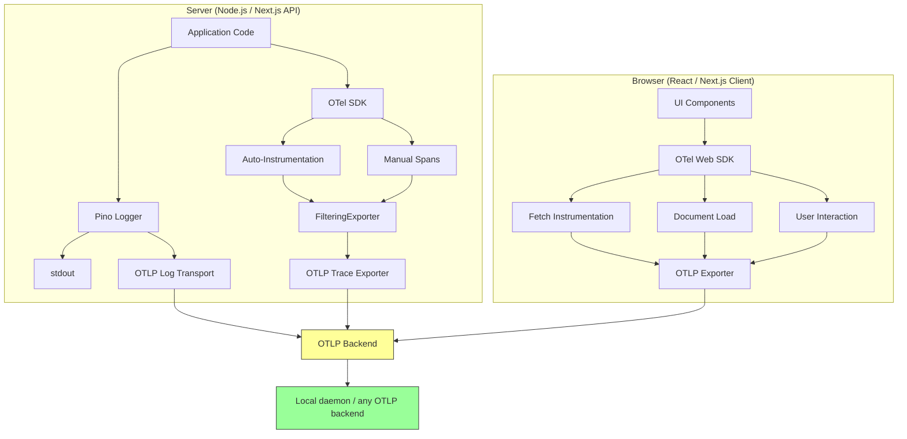

# OpenTelemetry

Auto-instrumentation, structured logging, and category-based filtering for every InDusk project. Spans go to the local daemon from the first run (`indusk telemetry address` prints where it listens), and any OTLP-compatible backend takes them by setting one endpoint variable.

## What `init` Creates

`indusk init` detects your runtime and scaffolds the right instrumentation into the app's own folder (the declared code repo in a workbench). Every server app also gets `telemetry-settings.ts` (the service named in code, the daemon's stored address as the default endpoint, the project and environment on every span) and the signal helper `signal` that writes a promise's signal as a span. Whatever `init` prints, it prints once and every command it names exists.

### Node.js (Express, Fastify, plain HTTP)

| File | Purpose |
|------|---------|
| `src/instrumentation.ts` | OTel SDK with auto-instrumentation + FilteringExporter |
| `src/filtering-exporter.ts` | Category-based span filtering |
| `src/logger.ts` | Pino structured logger (stdout + OTLP) |
| `src/telemetry-settings.ts` | Service name, the daemon's address, project and environment |
| `src/signal.ts` | The signal helper: `signal.upheld(...)` and `signal.broken(...)` |

**Wire it**: `node --import ./src/instrumentation.ts src/index.ts`

**Install**: `pnpm add @opentelemetry/api @opentelemetry/sdk-node @opentelemetry/auto-instrumentations-node @opentelemetry/exporter-trace-otlp-http @opentelemetry/sdk-trace-base @opentelemetry/resources @opentelemetry/semantic-conventions @opentelemetry/core pino pino-opentelemetry-transport`

### Next.js

| File | Purpose |
|------|---------|
| `instrumentation.ts` (root) | Server-side: `@vercel/otel` — API routes, server components, middleware |
| `src/instrumentation.web.ts` | Client-side: OTel Web SDK — page loads, fetch, user interactions |
| `src/logger.ts` | Pino structured logger (stdout + OTLP) |
| `src/telemetry-settings.ts` | Service name, the daemon's address, project and environment |
| `src/signal.ts` | The signal helper (server side) |

**Wire it**: Server loads automatically. Client: `import './instrumentation.web'` from a client component (one that starts with `"use client"`), not the root layout.

**Install**: `pnpm add @vercel/otel @opentelemetry/api pino pino-opentelemetry-transport @opentelemetry/sdk-trace-web @opentelemetry/sdk-trace-base @opentelemetry/exporter-trace-otlp-http @opentelemetry/resources @opentelemetry/semantic-conventions @opentelemetry/instrumentation @opentelemetry/instrumentation-fetch @opentelemetry/instrumentation-xml-http-request @opentelemetry/instrumentation-document-load @opentelemetry/instrumentation-user-interaction`

### React SPA (Vite)

| File | Purpose |
|------|---------|
| `src/instrumentation.ts` | OTel Web SDK — page loads, fetch, user interactions |
| `src/telemetry-settings.ts` | Service name, the daemon's address, project and environment |

**Wire it**: `import './instrumentation'` at the top of `main.tsx`

**Install**: `pnpm add @opentelemetry/sdk-trace-web @opentelemetry/sdk-trace-base @opentelemetry/exporter-trace-otlp-http @opentelemetry/resources @opentelemetry/semantic-conventions @opentelemetry/instrumentation @opentelemetry/instrumentation-fetch @opentelemetry/instrumentation-xml-http-request @opentelemetry/instrumentation-document-load @opentelemetry/instrumentation-user-interaction`

### Python

| File | Purpose |
|------|---------|
| `instrumentation.py` | OTel SDK setup, sending to the local daemon |
| `indusk_signal.py` | The signal helper (named so it does not hide Python's `signal` module) |

**Wire it**: `import instrumentation` as the first import of your entry point. Do not start the app through OpenTelemetry's `opentelemetry-instrument` wrapper: it builds its own tracer provider (the standard port, `unknown_service`) before the scaffold loads, so the spans would miss the daemon.

**Install**: `pip install opentelemetry-sdk opentelemetry-exporter-otlp-proto-http`

## A Promise's Signal

A behaviour promise's signal is a span written with the helper, never a log line; see [the signal helper](/reference/telemetry/signal-helper). A log line is for diagnosis.

## How to Add Manual Traces

Auto-instrumentation covers HTTP requests and database queries. You need manual spans for business logic, state transitions, and inference calls.

### Node.js / Next.js Server

```typescript
import { trace, SpanStatusCode } from '@opentelemetry/api';

const tracer = trace.getTracer('my-service');

// Basic span
const span = tracer.startSpan('poker.hand.deal', {
  attributes: {
    'otel.category': 'business',
    'room.code': roomCode,
    'hand.number': handNumber,
    'player.count': players.length,
  },
});

try {
  await dealCards(players);
  span.end();
} catch (err) {
  span.recordException(err);
  span.setStatus({ code: SpanStatusCode.ERROR, message: err.message });
  span.end();
  throw err;
}
```

### Wrapping async operations

```typescript
// Use startActiveSpan for automatic context propagation
await tracer.startActiveSpan('settlement.process', async (span) => {
  span.setAttribute('otel.category', 'business');
  span.setAttribute('settlement.amount', amount);
  
  try {
    const result = await processSettlement(hand);
    span.setAttribute('settlement.tx_hash', result.txHash);
    return result;
  } catch (err) {
    span.recordException(err);
    span.setStatus({ code: SpanStatusCode.ERROR });
    throw err;
  } finally {
    span.end();
  }
});
```

### LLM / Inference calls

```typescript
const span = tracer.startSpan('inference.gemini.generate', {
  attributes: {
    'otel.category': 'inference',
    'inference.model': 'gemini-2.5-flash',
    'inference.prompt_tokens': prompt.length,
  },
});

const response = await gemini.generateContent(prompt);

span.setAttribute('inference.completion_tokens', response.text.length);
span.setAttribute('inference.duration_ms', elapsed);
span.end();
```

### React / Browser

```typescript
import { trace } from '@opentelemetry/api';

const tracer = trace.getTracer('my-app');

function handleCheckout() {
  const span = tracer.startSpan('checkout.submit', {
    attributes: {
      'otel.category': 'business',
      'cart.item_count': cart.items.length,
      'cart.total': cart.total,
    },
  });

  submitOrder(cart)
    .then(() => span.end())
    .catch((err) => {
      span.recordException(err);
      span.setStatus({ code: SpanStatusCode.ERROR });
      span.end();
    });
}
```

## Span Naming Convention

Use `{domain}.{entity}.{action}`:

| Good | Bad |
|------|-----|
| `poker.hand.deal` | `processRequest` |
| `auth.session.create` | `handle` |
| `settlement.receipt.sign` | `doThing` |
| `inference.gemini.generate` | `callAPI` |
| `checkout.order.submit` | `submit` |

## Category Taxonomy

Every manual span gets an `otel.category` attribute:

| Category | What it covers | Auto-instrumented? | Examples |
|----------|---------------|-------------------|----------|
| `http` | HTTP server/client requests | Yes | GET /api/users, POST /api/orders |
| `db` | Database queries | Yes | SELECT, INSERT, pg, redis |
| `business` | Domain events | No | hand dealt, user registered, payment processed |
| `inference` | LLM/AI calls | No | Gemini generate, embedding create |
| `state` | State transitions | No | game started, order status changed |
| `system` | Infrastructure | No | health checks, cron jobs, queue processing |

## Category Filtering

Control which categories get exported via `OTEL_ENABLED_CATEGORIES`:

```bash
# Only HTTP and business spans
OTEL_ENABLED_CATEGORIES=http,business node --import ./src/instrumentation.ts src/index.ts

# Everything (default when not set)
node --import ./src/instrumentation.ts src/index.ts
```

The `FilteringExporter` wraps the real exporter and drops spans from disabled categories before they leave your process. **Instrument everything — you only pay export cost for enabled categories.**

## Structured Logging with Pino

Use the project logger, not `console.log`:

```typescript
import { logger } from './logger';

// Good — structured, with context
logger.info({ roomCode, players: players.length }, 'hand started');
logger.error({ err, orderId }, 'payment failed');
logger.warn({ queueDepth: 150, threshold: 100 }, 'queue approaching limit');

// Bad — unstructured string
console.log('Hand started for room ' + roomCode);
```

### Log Levels

| Level | Meaning | When to use |
|-------|---------|------------|
| `error` | Something is broken | Unhandled errors, failed operations that should succeed |
| `warn` | Degraded but functional | Approaching limits, fallback behavior, retries |
| `info` | What happened, for diagnosis | Completed operations, state changes worth reading around a failure |
| `debug` | Development details | Variable values, flow tracing — disable in production |

## Error Propagation

Errors must always include trace context. Never swallow silently:

```typescript
try {
  await processSettlement(hand);
} catch (err) {
  // Record on span
  span.recordException(err);
  span.setStatus({ code: SpanStatusCode.ERROR, message: err.message });
  
  // Log with context
  logger.error({ err, traceId: span.spanContext().traceId }, 'settlement failed');
  
  // Re-throw — don't swallow
  throw err;
}
```

## Trace Flow



## Environment Variables

### Server (Node.js / Python)

| Variable | Purpose | Default |
|----------|---------|---------|
| `OTEL_SERVICE_NAME` | Service name in traces | Named in `telemetry-settings.ts` |
| `OTEL_EXPORTER_OTLP_ENDPOINT` | Backend URL | The daemon's stored traces address (`indusk telemetry address`) |
| `OTEL_EXPORTER_OTLP_HEADERS` | Auth headers | Not set |
| `OTEL_ENABLED_CATEGORIES` | Active categories | All enabled |
| `LOG_LEVEL` | Pino log level | `info` |

### Browser (React / Next.js Client)

| Variable | Purpose | Prefix |
|----------|---------|--------|
| `VITE_OTEL_SERVICE_NAME` | Service name | Vite apps |
| `VITE_OTEL_EXPORTER_OTLP_ENDPOINT` | Backend URL | Vite apps |
| `VITE_OTEL_EXPORTER_OTLP_HEADERS` | Auth headers | Vite apps |
| `NEXT_PUBLIC_OTEL_EXPORTER_OTLP_ENDPOINT` | Backend URL | Next.js apps |
| `NEXT_PUBLIC_OTEL_EXPORTER_OTLP_HEADERS` | Auth headers | Next.js apps |
| `VITE_OTEL_PROPAGATE_TO` | Origins that receive the click's trace | Vite apps |
| `NEXT_PUBLIC_OTEL_PROPAGATE_TO` | Origins that receive the click's trace | Next.js apps |

### Following a click to an API on another origin

A `fetch` or `XMLHttpRequest` (so axios too) to the page's own origin carries the click's trace (a `traceparent` header) with no setting. A request to any other origin carries it only when the origin is named in `*_OTEL_PROPAGATE_TO`: a comma-separated list, where an entry containing `*` is a pattern.

```bash
VITE_OTEL_PROPAGATE_TO=http://localhost:3000,https://*.dev.example.com
```

- An entry without `*` is an exact origin (scheme, host and port). An entry that carries a path covers that path and what is under it, so `https://api.example.com/v1` covers `/v1/seats` and not `/v2/seats` or `/v10/seats`; a pattern entry follows the same rule. A path is compared as written, since a server tells `/Admin` from `/admin`; host and scheme case do not matter. A query or fragment on an entry is ignored, exact and pattern alike.
- `*` matches one or more characters other than `/` and `.`, so `https://*.dev.example.com` matches `https://plan-a.dev.example.com` and not `https://dev.example.com.evil.test`.
- Empty means same-origin only. A third-party origin you did not name never receives the header.
- An entry begins with its scheme (`https://`, or `*://`). One that does not can never match a request, so it is ignored with a console warning naming it; a bare `*` propagates nowhere.
- Entries are compared the way the browser spells a request URL, exact and pattern alike: host case does not matter and a default port (`:443` under `https`, `:80` under `http`) may be written or left off. Any other port is literal.
- The API must allow the `traceparent` header in its CORS settings (`Access-Control-Allow-Headers: traceparent`). `indusk init` prints this for React SPA and Next.js projects; it does not edit your server.

**A limit.** Only a request made synchronously in the click handler is in the click's trace. A request made after a native `await`, from a `.then()` callback or from a timer is in its own trace, not the click's: the template installs no context manager that carries the click across an asynchronous hop (zone.js cannot patch native `async`/`await`, and the AsyncContext proposal has not shipped). Make the request before the first `await`, or accept the separate trace.

## Connecting to a Backend

The scaffold already sends to the local daemon: the address is chosen once per machine and stored, `indusk telemetry address` prints it, and the app's `telemetry-settings.ts` reads it as the default. To send somewhere else, set the standard variable; a set endpoint wins over the default:

```bash
OTEL_EXPORTER_OTLP_ENDPOINT=https://your-collector.example.com  # any OTLP/HTTP backend
```

No code changes needed — all instrumentation uses standard OTLP. The standard port 4318 belongs to a recording server (`indusk server connect`), not to the local daemon.

## OTel Gate

Implementation phases have an **optional OTel gate** — enforced by hooks alongside the four required gates (verification, context, document). The gate is conditional on the project's `otel.role` field in `.indusk/config.json`:

| `otel.role` | Behavior |
|-------------|----------|
| *unset* (default) or `"service"` | OTel gate fires — phases must include `#### Phase N OTel` sections |
| `"library"` | OTel gate silenced — code ships to other people, never produces telemetry |
| `"tool"` | OTel gate silenced — short-lived script, telemetry overhead exceeds value |
| `"none"` | OTel gate silenced — explicit opt-out for legacy/prototype/internal experiments |

When the gate fires, the phase order is:

1. **Implementation** — build the thing
2. **OTel** — instrument it
3. **Verification** — prove it works (can include trace verification)
4. **Context** — capture what changed
5. **Document** — write/update docs

For projects with the gate silenced, the order is just **Implementation → Verification → Context → Document** — no OTel section is written and the planner skill skips it entirely.

The OTel gate asks: "did this phase add code paths that need instrumentation?" Example items (for projects where the gate fires):

```markdown
#### Phase 2 OTel
- [ ] New API endpoints have manual spans with `otel.category` and domain attributes
- [ ] Errors recorded with `recordException` + `setStatus(ERROR)` + trace-correlated log
- [ ] Inference calls have `inference.*` spans with model, token count attributes
```

For specific phases that don't add endpoints or business logic (config changes, documentation, tooling), individual items can also be opted out per the gate policy. But if your *whole project* is a library or tool, set `otel.role` instead — it's cleaner than per-phase opt-outs.

To set the role:

```json
// .indusk/config.json
{
  "mode": "full",
  "verify": { ... },
  "otel": {
    "role": "library"
  }
}
```

Backwards compatible: existing projects without the field continue to behave as `service`. The system stays loud by default — forgetting to instrument an app is worse than nagging.

## Eval Agent OTel (Opt-In)

The background eval agent — spawned on every `git commit` to score commits — has its own opt-in OTel tracing layer, separate from the per-project instrumentation above. Its purpose is internal observability: seeing what the eval agent is doing when it fails silently, instead of squinting at log files.

### Enabling

Pick either source (both are idempotent):

**Per-project** (`.indusk/config.json`):
```json
{
  "eval": {
    "otel": {
      "enabled": true,
      "dataset": "agent"
    }
  }
}
```

**Per-invocation** (env vars, win over config):
```sh
INDUSK_EVAL_OTEL=1 INDUSK_EVAL_OTEL_DATASET=agent git commit -m "..."
```

Endpoint comes from the standard `OTEL_EXPORTER_OTLP_ENDPOINT` env var — same one the per-project instrumentation uses. The exporter posts to `{endpoint}/v1/traces` (HTTP protobuf).

**Dataset routing.** Eval agent spans are routed to a named dataset through a dataset HTTP header on the OTLP exporter, for a backend that reads one. The default is `agent` — a dedicated bucket for eval agent traces so they don't mix with the project-under-evaluation's own traces. Override per-project via `eval.otel.dataset` in config or per-invocation via `INDUSK_EVAL_OTEL_DATASET`. A dataset header set directly via `OTEL_EXPORTER_OTLP_HEADERS` takes precedence (per OTel SDK contract).

### Default State

**OFF.** Zero cost in normal operation. No SDK init, no network, no provider registered. `initEvalOtel()` returns a no-op tracer and every `startSpan` produces a span whose `isRecording()` is `false`.

### Graceful Degradation

| Condition | Result | Logged to `<home>/eval/system.log` (`indusk eval home`) |
|-----------|--------|-------------------------------------|
| `enabled: false` (default) | No-op tracer | Nothing |
| `enabled: true`, no `OTEL_EXPORTER_OTLP_ENDPOINT` | No-op tracer | `eval.otel.enabled but OTEL_EXPORTER_OTLP_ENDPOINT is unset — falling back to no-op tracer` |
| `enabled: true`, endpoint set, SDK init throws | No-op tracer | `eval.otel init failed — falling back to no-op tracer: {message}` |
| `enabled: true`, endpoint set, SDK init succeeds | Real tracer | `eval.otel initialized — endpoint: {url}` |

**The eval agent never fails because of OTel.** Any init error is captured, logged, and the evaluator continues with no-op spans.

### Span Taxonomy (coming in Phase 2 of `improvement-eval-agent-open-telemetry`)

Phase 2 adds lifecycle spans around the evaluator's seven-step process:

- Root span: `eval.run` with attributes `changeId`, `source` (`commit` / `handoff` / ...), `mode` (`eval` / `baseline`), `projectGroup`
- Child spans: `eval.catchup`, `eval.read_transcript`, `eval.read_diff`, `eval.process_highlights`, `eval.answer_rubric`, `eval.write_findings`, `eval.write_scorecard`

Phase 3 adds per-highlight grandchildren under `eval.process_highlights`.

### Flushing Before Exit

The eval agent runs as a detached child process that exits quickly — batched spans can be lost on process termination. Always call `await shutdownEvalOtel()` in the exit path (`finally` block or `uncaughtException` handler).

### Service Identity

All eval agent spans carry the resource attribute `service.name = indusk-eval-agent`. This makes them easy to filter out in your backend if you only want to see spans from the project under evaluation, not the evaluator itself.

## Health Checks

The OTel extension verifies:
- `instrumentation.ts` (or `.py`) exists in the project
- OTel SDK packages are installed

Run `check_health` to see the status.
